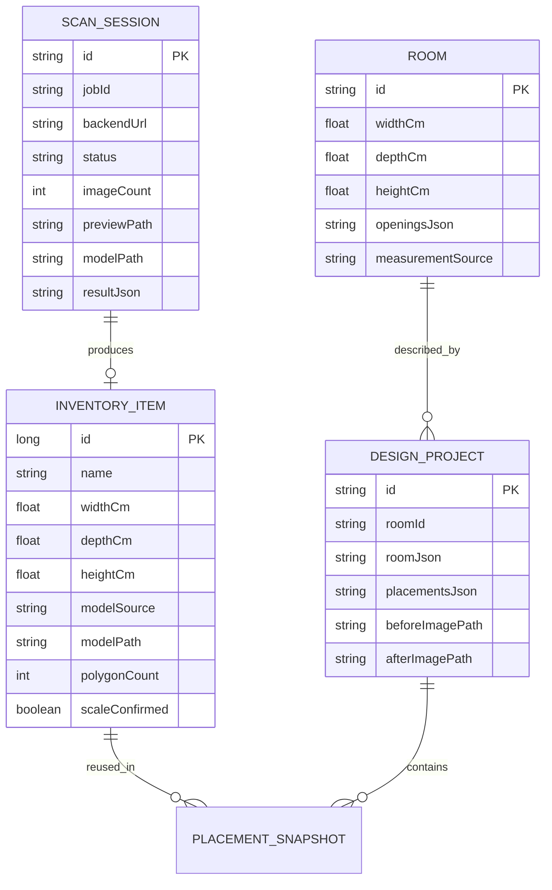

# Kiến trúc và thuật toán AR-SpaceFit

## Kiến trúc triển khai

```mermaid
flowchart LR
  A[Android: CameraX / bộ ảnh / video] -->|Multipart + bearer token| B[FastAPI]
  B --> J[(SQLite job state)]
  B --> Q[Single worker]
  B --> N[Native startup cache]
  Q --> N
  N -->|startup đạt| O[OpenCV: frame / blur / deduplicate]
  O --> C[COLMAP Linux CPU Docker: feature / matching / camera poses]
  C --> D[Docker adapter: attempt-only mount]
  D --> M[OpenMVS Linux CPU: dense / mesh / texture]
  M --> L[Blender: preview GLB]
  L --> U[Người dùng kiểm tra crop / hướng / số đo]
  U --> F[Blender: GLB đơn vị mét]
  F --> V[Android: SceneView / Filament]
  V --> I[(Room: My Furniture)]
  I --> E[Room Editor / Floor Plan]
  R[ARCore: ba điểm sàn] --> E
  E --> S[SpaceFit / LayoutPlanner]
  E --> P[ARCore Anchor Preview]
```



Runtime hiện tại: COLMAP CPU 3.9.1 và OpenMVS CPU 2.4.0 trong hai image bất biến; Blender Windows. Hai adapter chỉ mount attempt/diagnostic mới tại `/workspace`, không mount DB job hay bí mật; giao tiếp qua file trong cùng attempt. COLMAP mapper/undistortion và OpenMVS được kiểm trên scene tổng hợp, không suy ra quét vật thật đạt. Cache readiness chứa cấu hình cả hai runtime và ổ data; calibration chỉ phụ thuộc Blender. Xem [NATIVE_RUNTIME.md](NATIVE_RUNTIME.md).

## Dữ liệu



`PLACEMENT_SNAPSHOT` là phần tử trong JSON của project, không phải bảng SQL riêng. `roomId` và `scanSessionId` là liên kết logic; không tạo foreign key cưỡng bức. Snapshot giữ kích thước/model path ngay cả khi metadata trong kho được sửa. Xóa một món khỏi kho không xóa file GLB để tránh làm hỏng các thiết kế đang tham chiếu.

Room Database v4 thêm metadata GLB, `scan_sessions`, `rooms`, `design_projects`. Migration 3→4 chỉ thêm cột/bảng, không xóa dữ liệu. Migration 2→3 cũ vẫn được giữ trong chuỗi nâng cấp.

## Sequence của scan

```mermaid
sequenceDiagram
  actor U as Người dùng
  participant A as Android
  participant API as FastAPI
  participant W as Worker
  participant DB as SQLite / filesystem
  U->>A: Chụp / nhập 50–150 ảnh và số đo
  A->>DB: Lưu phiên cục bộ
  A->>API: GET /capabilities
  API-->>A: ready / runtime (startup check nền)
  Note over A,API: Chỉ upload khi cả bảy startup check đạt; đang kiểm tra/lỗi thì dừng
  A->>API: POST /jobs (X-Request-ID)
  API->>DB: Lưu upload, tạo job queued
  API-->>A: job id
  W->>DB: Lấy job / cập nhật stage
  Note over W,DB: checking_tools trước chuẩn bị ảnh; retry cũng preflight
  loop Theo dõi xử lý
    A->>API: GET /jobs/id
    API-->>A: status, progress, error
  end
  W->>DB: preview.glb / needs_review
  A->>API: Tải preview
  U->>A: Xác nhận hướng / crop / kích thước
  A->>API: POST /jobs/id/calibrate
  W->>DB: model.glb / completed
  A->>API: Tải model / thumbnail
  U->>A: Lưu My Furniture
```

## Hình học SpaceFit

Hệ tọa độ phòng có gốc tại tâm sàn: x theo chiều rộng, z theo chiều sâu, y hướng lên. Lưu vị trí/số đo bằng centimet; chuyển sang mét khi render GLB/AR. Model đã scan được scale đồng đều, tâm x/z ở gốc, đáy ở y=0.

Mỗi vật được xấp xỉ bằng footprint chữ nhật xoay theo góc Y và chiều cao phủ bì. Với điểm local `(x,z)`, quay trên mặt bằng: `x' = x cos θ − z sin θ`, `z' = x sin θ + z cos θ`. Filament quay Y ngược dấu để thống nhất phép chiếu x/z này.

- Trong phòng: mọi đỉnh footprint trong hình chữ nhật phòng, chiều cao đồ không vượt trần.
- Va chạm: Separating Axis Theorem trên trục pháp tuyến các cạnh của hai polygon. Tiếp xúc biên không coi là chồng lấn.
- Khoảng cách: khoảng cách nhỏ nhất từ đỉnh polygon này đến các đoạn cạnh của polygon kia; nếu chồng thì bằng 0.
- Chắn cửa: Sutherland–Hodgman cắt polygon footprint với vùng giữ trống cửa; phần trăm = diện tích giao / diện tích vùng cửa × 100.
- Cửa sổ: kiểm tra footprint giao vùng cửa và chiều cao đồ vượt bệ cửa.
- Điểm: tối đa 40 trong phòng + 25 khoảng trống + 20 không va chạm + 15 diện tích; trừ 25 khi chắn cửa/sổ. Tính phù hợp còn yêu cầu không vi phạm các ràng buộc cứng. Điểm không phải xác suất an toàn hay xác nhận lối đi liên tục.

## Gợi ý bố trí

`LayoutPlanner` giữ nguyên đồ khóa, xếp đồ còn lại theo diện tích giảm dần, khảo sát lưới 21×21 với góc 0° và 90°. Mỗi ứng viên qua `SpaceFitEngine`. Khoảng cách giữa đồ phải đạt mức khuyến nghị của phòng; ưu tiên phong cách gần tường hoặc thoáng trung tâm. Tạo tối đa ba hướng ưu tiên khác nhau. Chỉ trả phương án đủ tất cả đồ và qua kiểm tra cuối; không âm thầm bỏ đồ khi không xếp được.

Đây là heuristic, không chứng minh tối ưu toàn cục. Trường hợp không tìm ra không có nghĩa mọi cách bố trí đều bất khả thi. “Đồ nào vừa đây?” lấy giao vùng chọn với phòng, xét tâm hợp lệ gần tâm vùng nhất rồi lưới 11×11 cho từng góc 0°/90°. Kiểm tường/trần, footprint xoay và vùng cửa; không tìm mọi điểm/góc hoặc bảo đảm khoảng cách khuyến nghị/toàn tuyến đi lại.

`RegionFitSearch` chạy trên dispatcher nền, hỗ trợ hủy giữa các món; một bản ghi kho sai kích thước hoặc GLB chưa scale chỉ bị vô hiệu hóa, không làm sập toàn danh sách. Kết quả giữ snapshot thiết kế, vùng và đồ trong kho. Trước thêm, ViewModel đọc lại món trong Room, từ chối kết quả cũ khi món/project/bố cục đổi, kiểm lại hình học và validation, rồi cập nhật draft bằng compare-and-set. Đồ đang có giữ nguyên; không thêm trùng khi bấm lại và không vượt giới hạn 100 món. Không thay schema DB.

## Tái dựng và scale

COLMAP giải SfM từ ảnh; OpenMVS giải dense reconstruction và tạo bề mặt có texture. Các công cụ này được gọi bằng argv tách riêng với `shell=False`. Lỗi dừng pipeline và giữ dữ liệu để retry. Các phiên thử lại có workspace riêng.

Runtime Docker chỉ thay năm OpenMVS tool; COLMAP/Blender vẫn native. Adapter kiểm whitelist tool/argv/path, pin image ID/digest, giữ đường dẫn `/workspace` nhất quán giữa các stage và mount duy nhất attempt. Không có network/socket/token hoặc mount uploads/DB. CPU/RAM/pids có giới hạn, rootfs read-only. Container UUID riêng được dọn cả khi client timeout/cancel; worker shutdown đợi cleanup với ngân sách riêng, API vẫn đóng diagnostic checker nếu worker báo lỗi. Startup Docker dùng diagnostic mới dưới `data_dir` để không nhận nhầm ổ C sẵn sàng khi ổ E chưa được chia sẻ; thư mục con bị dọn sau probe.

Startup cache dùng chung cho API/worker: một batch nền, bảy lệnh help/version chạy song song trong thư mục tạm tách biệt, timeout 60 giây/công cụ, TTL 300 giây. Kết quả unchecked/checking/hết hạn không là ready. Doctor dùng cùng nhận dạng banner/exit code; đường dẫn tồn tại và generic help của executable khác không đủ. Calibration chỉ đòi Blender. Trạng thái này chỉ xác nhận khởi động, không xác nhận thuật toán native hoặc chất lượng tái dựng.

Photogrammetry đơn mắt chỉ khôi phục tỷ lệ tương đối. Khi người dùng nhập kích thước thật `d_real` và xác nhận trục sau khi chỉnh hướng, Blender lấy `d_model` từ hộp bao rồi nhân đồng đều `s = d_real / d_model`. Crop thực hiện trước rotation, đo extent sau rotation. Vì scale dựa vào hộp bao, nền còn dính hoặc hướng sai làm số đo sai. Bước người dùng xác nhận là một phần thuật toán của sản phẩm, không được bỏ khỏi báo cáo.

## Lỗi, ngoại tuyến và quyền riêng tư

- Android giữ ảnh và scan ID trên đĩa; tiến trình upload bị dừng có thể gửi lại cùng ID. Poll tiếp tục khi mở lại app đối với job đang xử lý.
- Server lưu job bằng SQLite; job đang chạy khi bị dừng được đánh dấu interrupted. Chưa khôi phục giữa một lệnh COLMAP/OpenMVS đang thực thi.
- GLB và thiết kế đã tải dùng được ngoại tuyến. Reconstruction cần kết nối laptop; Gemini là luồng độc lập cần Internet/key.
- Token Android được mã hóa bằng Keystore; không theo HTTP redirect kèm token. HTTP chỉ chấp nhận localhost/IP LAN trong client và chỉ bật cho bản debug.
- Filename upload do server sinh; không dùng đường dẫn người gửi. Có giới hạn số file, tổng dung lượng và thời gian stage. Đây là backend demo trong mạng tin cậy, chưa là dịch vụ đa tenant.

Tài liệu API gốc: [SceneView v2.3.0](https://github.com/SceneView/sceneview-android/tree/v2.3.0), [ARCore fundamentals](https://developers.google.com/ar/develop/fundamentals), [COLMAP CLI](https://colmap.github.io/cli.html), [OpenMVS](https://github.com/cdcseacave/openMVS/wiki/Usage).
