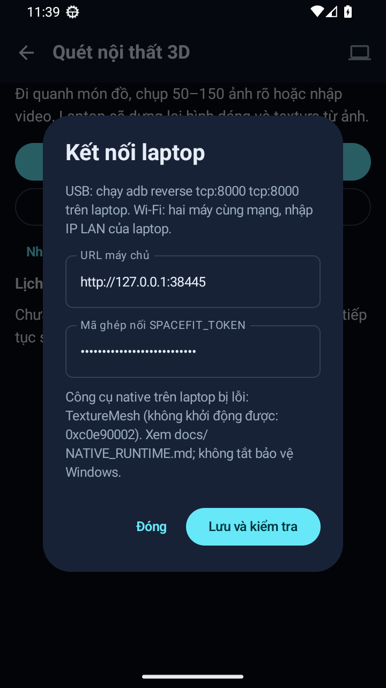
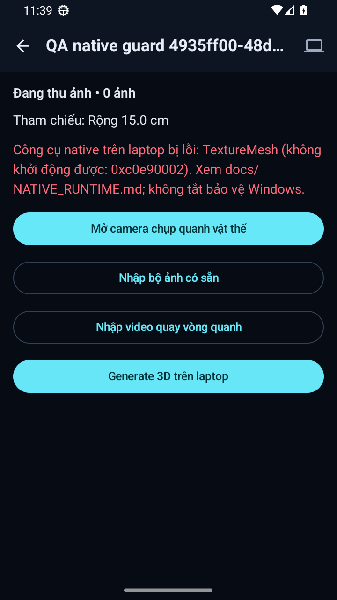
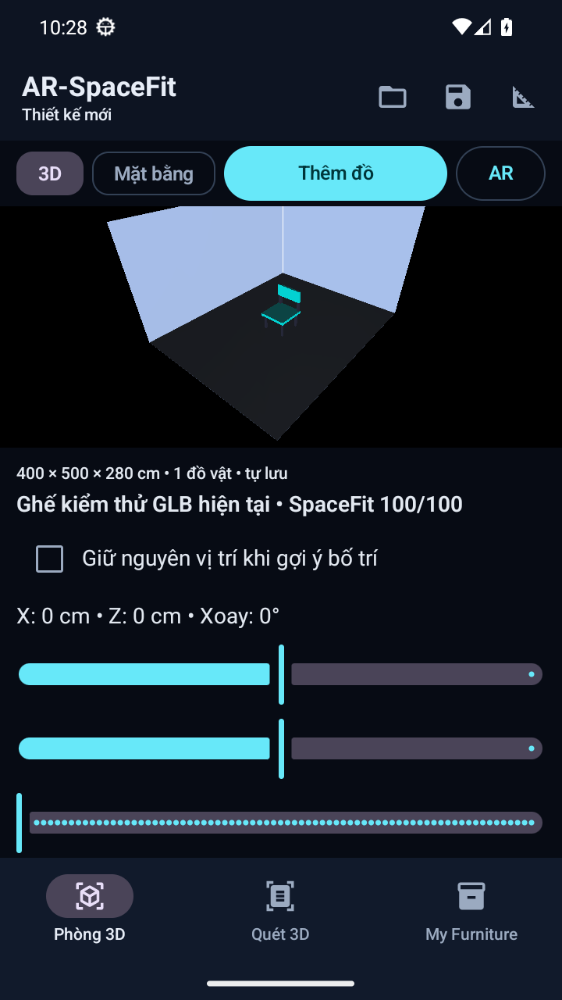
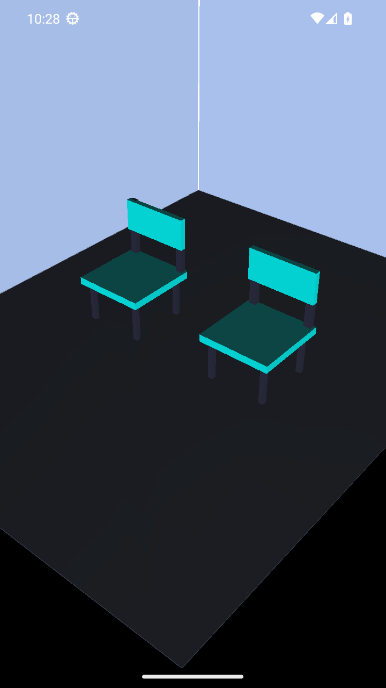
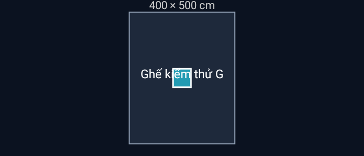
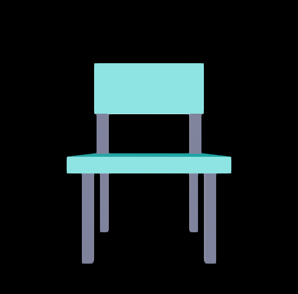
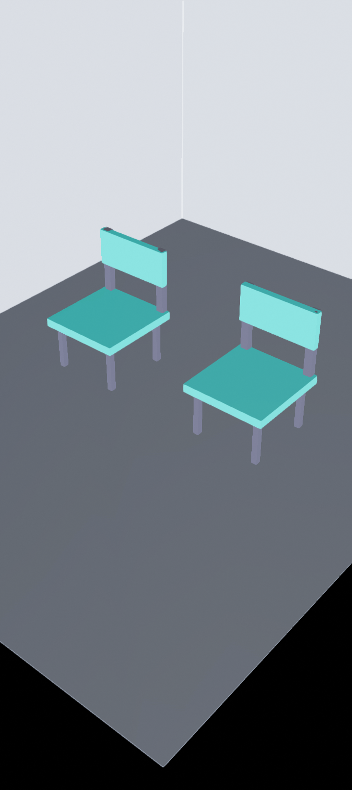
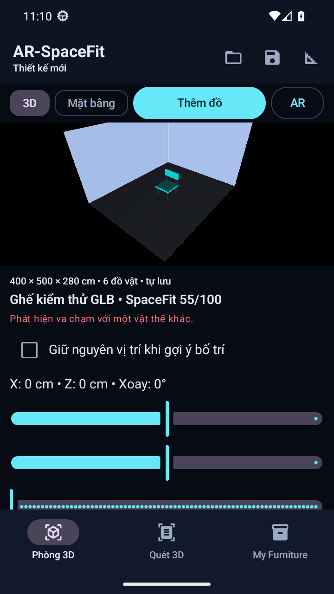

# Kết quả kiểm thử AR-SpaceFit

## 11/11/2026 — CI follow-up ở commit 151fe6e

- [Backend PR job](https://github.com/trunthong09012005/Ar-Spacefit/actions/runs/42975260838/job/130372756468) tại `151fe6e`: **6 failed/422 passed**, không còn nhóm lỗi đọc native config do rò env. Năm ca invalid resource/context thực tế đã từ chối tham số nhưng assertion câu tiếng Anh không chịu format xuống dòng. Checksum test lỗi `Get-FileHash` cmdlet/function unavailable. Android ở cùng run đã SUCCESS; đó là bằng chứng remote của commit cũ.
- Đổi kiểm tra validation sang mã lỗi và tên tham số; vẫn assert nonzero, Docker chưa được gọi, chưa có config. SHA-256 dùng .NET streaming thay Get-FileHash, giữ format checksum/path plain text và fail khi file không có. Không thay workflow, giới hạn native hoặc API ứng dụng.
- Regression: giới hạn PSModulePath đơn thuần cho **5 pass**, chưa tái hiện vì Windows PowerShell bổ sung đường dẫn mặc định. Loại function/tắt autoload trong process con cho RED **2 fail/3 pass**; bản sửa trung gian **2 fail/38 pass** vì Write-Output cũng cần module; dùng expression chuỗi thuần rồi GREEN **40 pass/0 fail/error/skip**, 20,26 s. Giữ red.xml, red-unavailable.xml, intermediate.xml và green.xml, không xóa lượt FAIL.
- Checkout từ Git archive, overlay ba file đã sửa, không có env/data/native config local: đúng nhóm backend của CI **432 pass/0 fail/error/skip**, 45,99 s; hai deprecation warning. Evidence `.tools/qa/ci-followup-20261111/clean.xml`, clean.log và tested-source-hashes.json. APK checksum từ helper khớp Python hashlib độc lập, lưu apk-hash-verification.txt. Đây là kiểm local; chưa có Actions run cho commit sửa mới.
- `tools/Test-All.ps1 -SkipAndroid -BlenderBin D:\Blender\blender.exe -RequireBlender -RequireDevice -RequireDocker -RequireColmapDocker`: core **428 pass**, HTTP **4 pass**, Blender **4 pass**, COLMAP **11 fail**, OpenMVS **1 pass/15 fail**, UI chưa chạy, Android build/JVM **SKIP có chủ đích** vì không thay mã Android. Scoped gate exit 1, không tính skip thành pass hoặc nhận là full gate. Evidence `.tools/qa/run-20261111-141437-239e7eda/` và ci-followup gate.log. Native doctor/scan/AR chưa nghiệm thu.

## 11/11/2026 — backend CI: rò environment và link log local

- Đọc [PR run](https://github.com/trunthong09012005/Ar-Spacefit/actions/runs/42359110873) và [push run](https://github.com/trunthong09012005/Ar-Spacefit/actions/runs/42358964384) của PR #2/commit `b1dbb43`: backend mỗi run **41 failed/353 passed/31 errors**, Android đã SUCCESS. Nguyên nhân đầu: test doctor để lại `SPACEFIT_COLMAP_RUNTIME=docker`, dẫn tới FileNotFoundError cho config riêng máy ở các test phía sau; không phải cần đưa config đó lên GitHub.
- Regression mới trong `test_import_isolation.py` chạy thật hai ca doctor trong process con, so runtime trước/sau khi bắt đầu absent/native/docker. RED **1 fail/2 pass** (ca absent rò docker), 1 test không thuộc lựa chọn bị deselect; sau sửa `monkeypatch.setenv` để quản lý undo rõ ràng, hai file doctor/import có **9 pass**. Không sửa doctor/config nghiệp vụ hoặc tắt test.
- Bản source từ Git archive, overlay test đã sửa, không copy `.env`, data, virtualenv hay native config vào checkout: chạy đúng ba ignore native của workflow, môi trường process con loại cấu hình SPACEFIT/native kế thừa. Lượt đầu **427 pass/1 fail** do link `.tools/qa` trong REQUIREMENTS_ACCEPTANCE không được Git quản lý. Sửa tài liệu thành mã run local/plain text, giữ báo cáo lịch sử và link TEST_RESULTS. Lượt cuối **428 pass/0 fail/error/skip**, 50,90 s, hai deprecation warning. JUnit helper đọc report đạt; hash ba file sửa khớp source được kiểm.
- Evidence `.tools/qa/ci-failure-20261111/`: log remote, environment-leak-repro, red.xml/log, green.xml, docs-green.xml, base archive/clean-checkout, clean-backend.xml/log (FAIL), final-backend.xml/log (PASS), clean-checkout-verification.json. Đây là kiểm backend local tương đương lựa chọn CI trên checkout sạch, chưa phải kết quả Actions ở commit sửa và không nghiệm thu reconstruction/AR.
- Cổng Test-All theo TESTING dùng JDK 25.0.2, Blender, Offline và RequireBlender/Device/Docker/ColmapDocker; summary `.tools/qa/run-20261111-133952-f5d29c45/`: backend core **424 pass**, HTTP **4 pass**, Blender **4 pass**, Android JVM **117 pass**; build/lint và hai APK thành công. COLMAP **11 fail**, OpenMVS **1 pass/15 fail**; UI chưa chạy do không chọn emulator QA, gate FAIL. Native startup/scan thật/AR chưa nghiệm thu; không đổi lỗi môi trường thành PASS. Report và log được giữ nguyên.

## 07/11/2026 — CI nền và APK artifact

- Workflow Windows backend/Android và gate tổng hợp; giới hạn CI nền: không chạy Blender, COLMAP/OpenMVS thật hoặc UI/AR trên thiết bị. Ba nhóm native được loại công khai khỏi command backend, không đánh dấu là đã pass. Chưa chạy trên GitHub; cần push nhánh và kiểm run thật. Không triển khai backend/release theo lựa chọn người dùng.
- Regression report gate: trước helper, pytest **1 fail/7 pass** đúng ca report hợp lệ cần được chấp nhận; các ca âm trả nonzero vì script chưa có, chưa chứng minh xử lý âm. Sau helper: 8 ca đều đạt, gồm thiếu report, XML lỗi, không có suite, 0 test, failure, error, skip và report hợp lệ. Chạy kèm local-doc links: **31 pass/0 fail/error/skip** (23 tài liệu + 8 ca), JUnit `.tools/qa/ci-20261107/targeted.xml`; RED log/XML cùng thư mục.
- actionlint **v1.7.12** exit 0 cho `.github/workflows/ci.yml`; binary ZIP upstream SHA-256 `6e7241b51e6817ea6a047693d8e6fed13b31819c9a0dd6c5a726e1592d22f6e9` khớp trước giải nén/chạy. Actionlint log cùng QA; kiểm thêm YAML BaseLoader, SHA pin 40 ký tự, quyền read-only, needs/always gate và parse các block PowerShell. Không chạy script download tùy ý hoặc cài tool toàn máy.
- Lệnh Test-All: JDK 25.0.2, Blender, Offline, RequireBlender/RequireDevice/RequireDocker/RequireColmapDocker; evidence `.tools/qa/run-20261107-160953-04219f70/`. Core **421 pass**, HTTP **4 pass**, Blender **4 pass**, Android JVM **117 pass**, build/lint/debug APK và instrumentation APK thành công. COLMAP **11 fail**, OpenMVS **1 pass/15 fail**, UI **chưa chạy** (không có QA emulator được chọn). Tổng gate **exit 1**. Doctor/scan thật/AR chưa nghiệm thu.
- Probe Docker read-only đúng desktop-linux với quyền runtime xác nhận pipe `dockerDesktopLinuxEngine` không tồn tại; lưu `docker-readiness.log`. Probe sandbox ban đầu không đủ quyền đọc metadata context, không dùng lỗi đó để kết luận daemon. Không restart Docker/WSL, đọc DB/token, chạy lại job thật hoặc cài app.
- APK local SHA-256 `D8E9754DE3987825DA0AF2A78E2483F8BECA4C960F4151819653BD9339AA876D`; không phải artifact do GitHub build. Không suy ra chữ ký cập nhật điện thoại hoặc chất lượng quét thật từ APK build thành công.

## 07/11/2026 — chia commit và nhánh Gitflow

- Git CLI có sẵn; extension `git flow` chưa cài và không cần để dùng mô hình nhánh. Tạo develop/feature, commit Conventional Commits tiếng Anh và tích hợp `--no-ff` bằng worktree local riêng; main giữ nguyên. Chỉ thao tác Git local, không push/tag/release hoặc thay chính sách GitHub.
- Có danh sách riêng cho **329 đường dẫn** trong 6 nhóm; index phải khớp đúng nhóm trước commit. `git diff --cached --check` đạt cho các phần đã review. Lượt đầu kiểm index Android dừng vì Git hiển thị rename thành một đường dẫn thay vì cặp cũ/mới; sửa phép đối chiếu dùng `--no-renames`, giữ nguyên cách Git nhận diện rename trong commit, không bỏ qua file.
- Probe file nguồn/tài liệu theo allowlist không phát hiện Google/GitHub/AWS key pattern, private key header hoặc conflict marker. Đây là kiểm giới hạn, không phải secret audit toàn lịch sử. Lượt đầu rule đường dẫn quá rộng nhận nhầm package Kotlin `data` là runtime; sửa thành chính xác `backend/data/`, sau đó vẫn quét toàn bộ source Kotlin. Không đọc cấu hình bí mật hoặc DB.
- Kiểm liên kết tài liệu gồm GITFLOW: **22 pass**, 0 fail/error/skip; JUnit `.tools/qa/gitflow-20261107/docs.xml`. Hash manifest xác nhận không sửa mã sản phẩm khi chia commit; chỉ tài liệu Gitflow và báo cáo được cập nhật. Không chạy lại suite runtime cho thao tác Git/Markdown; bằng chứng mã đã kiểm trước đó ở `run-20261107-153628-1f60e3cb`, giữ nguyên lỗi Docker và UI chưa chạy.
- Evidence `.tools/qa/gitflow-20261107/` gồm commit-plan, danh sách file NUL, staged patch, hash manifest, log và commit/merge ID. Kiểm ref/index/worktree sau tích hợp được ghi riêng trong QA, không dùng việc commit để suy ra test sản phẩm đạt.
- Staged whitespace check nhóm tài liệu phát hiện hai dòng cũ: dòng trống trong reference threat-model và hard break bằng hai dấu cách trong hướng dẫn chạy. Bỏ khoảng trắng ở dòng trống, đổi hard break thành đoạn văn; không sửa nội dung nghiệp vụ. Giữ bản reference trước sửa trong QA, đối chiếu hash trước khi cập nhật file được bảo vệ.

## 07/11/2026 — dọn scaffolding không dùng

- Chuyển `metadata.json` và `public/` (chỉ một `.gitignore` AI Studio) vào `archive/unused-scaffolding-20261107/`. Kiểm tham chiếu mã/build/script hiện hành không thấy consumer; hai file lưu trữ khớp SHA-256 với nguồn, nguồn không còn ở gốc. Không sửa mã sản phẩm, test hoặc cấu hình build.
- Lệnh `backend/.venv/Scripts/python.exe -B -m pytest test/backend/test_repository_documentation.py -q -p no:cacheprovider --junitxml=.tools/qa/cleanup-20261107-scaffolding/docs.xml`: **21 pass**, 0 fail/error/skip, 0,11 s. `git diff --check` đạt; `git check-ignore` xác nhận hai đường dẫn archive không đưa vào Git. Manifest cùng thư mục QA.
- Không chạy lại suite runtime/build/native/UI cho thay đổi scaffolding/Markdown; không suy ra chất lượng app hoặc Gen3D từ kiểm tra tài liệu. Giữ nguyên dữ liệu/môi trường/bằng chứng lịch sử và các blocker trước đó.

## 07/11/2026 — mã test tập trung trong `test/`

- Cấu trúc: `test/backend/`, `test/android/unit/`, `test/android/instrumentation/`; root `pytest.ini` và Gradle source sets được cập nhật. Test-All dùng đường dẫn mới. Đối chiếu 62 file gốc sau di chuyển trước khi chỉnh path; baseline ảnh và package Kotlin được giữ. Discovery trước **445**, sau **446** (thêm một trường hợp kiểm liên kết `test/README.md`).
- Chạy Test-All với JDK 25.0.2, Blender, offline và yêu cầu Blender/device/Docker/COLMAP. Evidence `.tools/qa/run-20261107-153628-1f60e3cb/summary.json` và log/JUnit từng nhóm. Backend core **411/411**, HTTP black-box **4/4**, Blender integration **4/4**, Android JVM **117/117** đạt, không skip trong các nhóm này. Gradle build, lint, APK debug và instrumentation APK thành công.
- Docker Engine không truy cập được: COLMAP **0 pass/11 fail**, OpenMVS **1 pass/15 fail**. UI bị chặn vì không chọn QA emulator; không chạy test trên điện thoại thật. Gate **exit 1**, native doctor/scan thật/AR chưa được nghiệm thu. Các thất bại và phần chưa chạy không tính PASS; chuyển thư mục không chứng minh Gen3D thật đã đạt chất lượng.
- Evidence cấu trúc/discovery: `.tools/qa/test-layout-20261107-f9b2/`. Không chạy lại job thật, đọc DB/token hoặc thay đổi dịch vụ/Windows policy.

## 07/11/2026 — commit rules và kiểm .gitignore bằng Git thật

- Thêm `.agents/rules/git-and-commits.md`, định tuyến AGENTS/CONTRIBUTING; format/type/scope/ví dụ và chính sách stage/share. File được soạn bằng apply_patch trong QA rồi cài bằng lệnh được cấp quyền vào `.agents/rules`, target chưa tồn tại và hash khớp. Không sửa skill Git, cài hook/commitlint, stage, untrack, commit hoặc push trên repo thật.
- Giữ .gitignore cũ trong `.tools/qa/git-rules-20261107-d42e/gitignore.before`; thêm secret/env/signing, output Android, DB journal và Python env/cache. Chỉ dùng đường dẫn tổng hợp để kiểm, không đọc nội dung `.env`, key hoặc DB.
- Probe đầu **FAIL**: Python text-mode chuyển stdin sang CRLF, Git check-ignore coi CR là một phần tên file và trả false negative. Kết quả giữ trong `ignore-probe-failed.json`. Đối chiếu lệnh Git trực tiếp và repr stdin/stdout xác định lỗi transport; sửa probe dùng binary NUL `git check-ignore --no-index -z --stdin`, giữ nguyên expectations.
- `backend/.venv/Scripts/python.exe -B .tools/qa/git-rules-20261107-d42e/check_ignore.py`: baseline fixture .gitignore cũ **32/64 không đáp ứng**, bản mới và repo thật **64/64 đúng** = 48 đường dẫn cần ignore + 16 source/template/assets cần giữ. Probe là repo Git rỗng riêng trong QA, không có commit. `ignore-validation.json` ghi từng mismatch baseline, bản mới không mismatch. Đây là kiểm rule Git, không phải 64 test ứng dụng.
- `git ls-files -ci --exclude-standard -z` trên repo thật: **0 file tracked khớp ignore**. Không tương đương secret scan hoặc chứng minh lịch sử Git không có bí mật; .gitignore không bỏ track file đã có.
- Pytest `backend/tests/test_repository_documentation.py` với basetemp mới và JUnit `.tools/qa/git-rules-20261107-d42e/docs.xml`: **20 pass/0 fail/error/skip**, 0,08 s. `git diff --check` được kiểm trước bàn giao. Chỉ sửa .gitignore/Markdown: không chạy Test-All/native/Android/UI hay các suite ứng dụng khác, không thay dữ liệu/runtime; blocker trước đó giữ nguyên.

## 07/11/2026 — viết system rules và cập nhật routing

- Tạo `.agents/rules/system-rules.md`, cập nhật AGENTS startup, chỉ mục agent và docs README. Nội dung điều phối dẫn tới các rule chất lượng/dữ liệu đã có; không sửa skill, mã sản phẩm, môi trường hoặc dữ liệu thật. File được soạn bằng apply_patch trong `.tools/qa/system-rules-20261107-b908/` rồi cài vào thư mục bảo vệ bằng thao tác được cấp quyền. Target phải chưa tồn tại, file cài khớp SHA-256, README hiện tại phải khớp hash trước review và có backup; `installation.json` ghi kết quả.
- Kiểm **30 tài liệu Markdown agent/AGENTS, 43 link local, 0 hỏng/thoát repo**; xác nhận AGENTS trỏ system rules và vẫn có 16 entrypoint skill. `validation.json` lưu bằng chứng cấu trúc; không phải test hành vi runtime của agent.
- `backend/.venv/Scripts/python.exe -B -m pytest backend/tests/test_repository_documentation.py -q -p no:cacheprovider --basetemp .tools/qa/system-rules-20261107-b908/docs-temp --junitxml .tools/qa/system-rules-20261107-b908/docs.xml`: **20 pass/0 fail/error/skip**, 0,08 s. `git diff --check` đạt; cảnh báo CRLF cũ giữ nguyên.
- Chỉ viết/cập nhật Markdown: không chạy unit/integration ứng dụng, Test-All, Docker/Blender, Android/UI hoặc kiểm server/job thật. Không đọc secret/DB/video/log cá nhân, không mở/restart dịch vụ hoặc commit. Kết quả cấu hình không được tính thành nghiệm thu app/Gen3D/AR; blocker trước đó không đổi.

## 07/11/2026 — chọn skill từ bộ tham khảo và thích nghi cho AR-SpaceFit

- Theo ảnh người dùng: thêm bản thích nghi `api-design`, `docker-patterns`, `systematic-debugging`, `test-driven-development`, `verification-before-completion`. Nguồn local `E:\AgriAI\.agents\skills\`; snapshot SKILL/LICENSE của từng mục **10 file đối chiếu SHA-256 khớp**, giữ trong `.tools/qa/skills-from-reference-20261107-f27a/originals/`, `source-manifest.json`. Giữ 5 LICENSE gốc; không tuyên bố nguồn local là upstream chưa sửa hoặc pin được revision Git của nguồn.
- Nội dung được rút gọn cho stack và rule AR-SpaceFit: giữ hợp đồng API hiện có, mount native đúng attempt, bảo vệ mã người dùng, dùng test framework hiện có và phân biệt kiểm tài liệu với nghiệm thu runtime. Không sao chép framework/script/context của project AgriAI. Không cài skill trùng hoặc ngoài stack theo bảng lựa chọn ở SKILLS.md.
- Staged tại `.tools/qa/skills-from-reference-20261107-f27a/skills/`; 5 skill staged qua validator trước khi cài bằng thao tác được cấp quyền vào `.agents/skills/`. Kiểm trước toàn bộ destination chưa tồn tại; sau copy **15 file khớp hash** (`installed-files.json`), không ghi đè skill cũ. Không sửa project nguồn; 10 file nguồn vẫn khớp checksum sau cài.
- Validator chính thức `skill-creator/scripts/quick_validate.py` trên toàn bộ thư mục hiện tại: **16/16 hợp lệ**, metadata/routing **16/16**, icon có tham chiếu tồn tại. Kiểm Markdown AGENTS/agent: **30 link local/0 hỏng**. Snapshot `.agents`: **59 file**. Báo cáo `validation.json`, `structure-validation.json`, `snapshot-sha256.json`; đây là kiểm cấu hình, không chứng minh hành vi runtime của từng skill.
- `backend/.venv/Scripts/python.exe -B -m pytest backend/tests/test_repository_documentation.py -q -p no:cacheprovider --basetemp .tools/qa/skills-from-reference-20261107-f27a/docs-temp --junitxml .tools/qa/skills-from-reference-20261107-f27a/docs.xml`: **20 pass/0 fail/error/skip**, 0,10 s. `git diff --check` đạt với cảnh báo CRLF đã có. Validator dùng PyYAML QA đã cài, không thay dependency sản phẩm.
- Không chạy Test-All hoặc unit/integration ứng dụng/native/Android/UI cho lượt chỉ cài skill/Markdown. Không thực thi helper nguồn, khởi động/restart dịch vụ, đăng nhập GitHub, đọc dữ liệu thật hoặc sửa app. Kết quả sản phẩm và các blocker ở các lượt trước giữ nguyên; không thêm pass runtime từ việc validate skill.

## 07/11/2026 — thêm skill frontend, GitHub và hạ tầng phát triển

- Cài `gh-address-comments` và `gh-fix-ci` bằng installer chính thức, `--repo openai/skills --ref 49f948faa9258a0c61caceaf225e179651397431 --path skills/.curated/gh-address-comments skills/.curated/gh-fix-ci --dest E:/ar-spacefit/.agents/skills`. Chỉ tải/cài, không xác thực GitHub hoặc thực thi helper gọi API. Tạo `spacefit-frontend`, `spacefit-git-workflow`, `spacefit-devops`; giữ sáu skill trước đó, tổng 11.
- Ghi trực tiếp `.agents` bằng apply_patch bị sandbox từ chối tạo parent directory. Đã soạn ba skill trong QA, validate rồi cài bằng `exec_command require_escalated` được cấp quyền; không có auto-review rejection hoặc thay policy hệ thống. Destination skill phải chưa tồn tại, file copy được so hash. Hai file `.agents/README.md` và `workflows/code-change.md` được đối chiếu với bản hiện tại trước copy, giữ bản trước thay đổi trong QA. AGENTS và tài liệu cũng được cập nhật theo phạm vi.
- Validator `skill-creator/scripts/quick_validate.py`: **11/11 hợp lệ**. Parse metadata/routing của cả bộ, kiểm icon upstream tồn tại và parse AST hai script Python GitHub thành công; không coi syntax check là đã kiểm hành vi helper/đăng nhập. Kiểm local links trong AGENTS/Markdown agent và lưu `structure-validation.json`; snapshot giữ hash file hiện tại, provenance upstream pin revision rõ ràng.
- `backend/.venv/Scripts/python.exe -B -m pytest backend/tests/test_repository_documentation.py -q -p no:cacheprovider --basetemp .tools/qa/skills-expand-20261107-c83b/docs-temp --junitxml .tools/qa/skills-expand-20261107-c83b/docs.xml`: **20 pass/0 fail/error/skip**, 0,36 s. `git diff --check` đạt, cảnh báo CRLF đã có. Không thêm dependency sản phẩm; validator dùng PyYAML trong QA đã có.
- Evidence `.tools/qa/skills-expand-20261107-c83b/`: `validation.json`, `structure-validation.json`, `snapshot-sha256.json`, `docs.xml`, staged skills và bản gốc hai file routing. GitHub CLI có trên máy nhưng auth/access chưa kiểm; không commit, push, PR, chạy Actions, tạo deployment hoặc cài cloud/database service. Không sửa mã sản phẩm, không chạy Test-All/backend suites/native/Android/UI trong lượt cài skill; blocker sản phẩm trước đó không đổi.

## 06/11/2026 — tổ chức .agents theo mẫu, tinh gọn reference

- Scope: Markdown/skill; `.agents/{commands,references,rules,skills,workflows}/`, README và routing AGENTS. Đối chiếu hai đoạn rule trước khi bỏ bản trùng khỏi AGENTS: **nguyên văn được giữ đủ**, kết quả `rule-migration.json`. Không sửa mã/build/runtime, không thực thi các công thức lệnh mới.
- Trước khi gỡ 9 reference không thuộc stack (Go, JavaScript, Django, Flask), copy từng file và so SHA-256; **9/9 backup khớp**. File hoạt động bị gỡ bằng apply_patch, không xóa bản sao. Nơi phục hồi `.tools/qa/agents-layout-71d1a1da0149414e86b4af7ecb784827/removed-references/`, manifest `removed-references.json`. Giữ FastAPI reference và LICENSE; thu hẹp mô tả `security-best-practices` để không quảng bá các reference đã gỡ.
- `skill-creator/scripts/quick_validate.py` chạy với Python venv và PyYAML QA riêng đã có: **6/6 skill hợp lệ**; `skill-validation.json`. Kiểm thư mục: đúng 5 folder yêu cầu. Kiểm liên kết local Markdown: **19 tài liệu/30 liên kết/0 hỏng/0 thoát repo**; `agent-links.json`. Đây là kiểm cấu trúc/tính điều hướng, không phải kiểm hành vi runtime của agent hay ứng dụng.
- `backend/.venv/Scripts/python.exe -B -m pytest backend/tests/test_repository_documentation.py -q -p no:cacheprovider --basetemp .tools/qa/agents-layout-71d1a1da0149414e86b4af7ecb784827/docs-temp --junitxml .tools/qa/agents-layout-71d1a1da0149414e86b4af7ecb784827/docs.xml`: **20 pass/0 fail/error/skip**, 0,10 s. `git diff --check` đạt, vẫn có cảnh báo CRLF đã biết.
- Không chạy lại unit/integration mã sản phẩm, native, Android/UI hoặc Test-All vì chỉ sửa hướng dẫn. Không đọc bí mật/DB/log thật hoặc mở/restart dịch vụ. Không chuyển các blocker Docker/UI/scan thật trước đó thành PASS.

## 06/11/2026 — cài skill và quy tắc sử dụng, không sửa mã sản phẩm

- Cài hai skill upstream `security-best-practices`/`security-threat-model` bằng `skill-installer/scripts/install-skill-from-github.py --repo openai/skills --path skills/.curated/security-best-practices skills/.curated/security-threat-model --dest E:/ar-spacefit/.agents/skills`. Ref `main` tại thời điểm tải; checksum snapshot 26 file lưu riêng, không tuyên bố ref bất biến hoặc đã thực hiện audit bảo mật.
- Tạo bốn skill repository: `spacefit-android`, `spacefit-backend`, `spacefit-gen3d`, `spacefit-verification`, mỗi skill có `SKILL.md` và `agents/openai.yaml`. Thêm bảng scope bắt buộc trong AGENTS và tài liệu SKILLS; không sửa runtime/build/app code.
- `skill-creator/scripts/quick_validate.py` chạy cho cả sáu folder: **6 hợp lệ/0 lỗi**. Parse metadata YAML: **6/6**, entry point của bốn component có thật, AGENTS trỏ đủ sáu skill. Đây là kiểm metadata/đường dẫn, không phải sáu test chức năng ứng dụng hoặc chứng minh skill xử lý chính xác mọi task.
- `backend/.venv/Scripts/python.exe -B -m pytest backend/tests/test_repository_documentation.py -q -p no:cacheprovider --basetemp .tools/qa/skills-validation-20261106-a61d9f/docs-temp --junitxml .tools/qa/skills-validation-20261106-a61d9f/docs.xml`: **20 pass/0 fail/error/skip**, 0,10 s. Kiểm link tài liệu hiện hành, không truy cập dữ liệu quét thật. `git diff --check` được kiểm trước bàn giao.
- Bằng chứng `.tools/qa/skills-validation-20261106-a61d9f/`: `validation.json`, `snapshot-sha256.json`, `docs.xml`. Validator thiếu PyYAML trong backend venv; đã cài PyYAML **6.0.3** bằng pip `--target` vào `validator-deps/` dưới run QA và chỉ đặt PYTHONPATH trong process kiểm tra, không thay requirements/môi trường ứng dụng. Lệnh `py` của máy không tìm thấy Python, nên dùng Python venv hiện có.
- Không chạy lại unit/integration sản phẩm, Test-All, Docker/Blender native hoặc Android/UI trong lượt cài skill; không coi kết quả cũ là pass mới. Không đọc DB/token hoặc mở/restart dịch vụ. Gate trước vẫn FAIL do Docker/UI như mục dưới. Chưa kiểm độc lập hành vi skill trên task runtime; chưa tuyên bố app an toàn/hoàn thiện nhờ cài skill.

## 06/11/2026 — tái tổ chức repository, Android/build hoạt động ở đường dẫn mới

Phạm vi thay đổi: Android `app/` → `apps/android/` với Gradle module `:app` giữ nguyên; Dockerfile → `infra/docker/{openmvs,colmap}/`; báo cáo → `docs/reports/`; cập nhật build/script/installer/test/link. Không đổi thuật toán Gen3D, DB schema, application ID hoặc dữ liệu runtime. Giữ dirty worktree ban đầu, không commit.

### Bảo toàn và regression

- Manifest `.tools/qa/repository-layout-3026d9f436d24a409d505bd0a13e1fc7/move-verification.json`: **116 file** so SHA-256 trước/sau move (108 Android, 5 Docker, 3 báo cáo); kiểm lại sau build **108 Android gốc không đổi**, không thiếu file tracked tại vị trí mới. 26 log rời được chuyển nguyên file sang `artifacts/diagnostics/root-20261106/`, không đọc nội dung/xóa. APK/build, artifacts, `.env` và DB vẫn bị gitignore. Không đọc token hoặc DB/video/log job thật.
- Setup contract `test_colmap_setup.py` + `test_docker_setup_contract.py`: **45 pass**, 16,92 s, fixture/mock bên ngoài rõ ràng. JUnit `targeted.xml` trong thư mục manifest.
- Test mới `test_repository_documentation.py` tái hiện link sai của hướng dẫn chạy: RED **18 pass/1 fail**, 0,10 s (`docs-red.xml`). Sửa 6 link, GREEN **19 pass**, 0,07 s (`docs-green.xml`). Kiểm tài liệu hiện hành, không quét private/runtime và không sửa lịch sử. Core riêng sau đó **409 pass**, 53,70 s (`core-final.xml`); đã bao gồm 19 test tài liệu, không cộng thêm vào tổng gate.
- 6 file PowerShell parse không lỗi; `git diff --check` đạt (có cảnh báo CRLF). Không nâng dependency/đổi bảo vệ Windows.

### Các lần chạy và kết quả cuối

Lệnh trực tiếp `tools/Test-All.ps1` ban đầu bị ExecutionPolicy của shell chặn. Đã chạy bằng `powershell.exe -NoProfile -ExecutionPolicy Bypass -File ...` cho tiến trình kiểm thử, không đổi policy hệ thống/người dùng.

Gate trong sandbox `run-20261106-093545-22b83632`: core **390 pass**, HTTP **4 pass**, Blender **4 pass**, COLMAP **11 fail**, OpenMVS **16 fail**; Android chưa chạy test vì wrapper không dùng được cache và bị chặn kết nối tải Gradle (`Permission denied: connect`). UI FAIL/chưa chạy vì không chọn emulator. Giữ nguyên run FAIL, không dùng báo cáo Android đã có sẵn làm bằng chứng mới.

Android riêng ngoài sandbox dùng `GRADLE_USER_HOME=C:\Users\GIGABYTE\.gradle`, JDK 25.0.2, `:app:projects :app:testDebugUnitTest :app:lintDebug :app:assembleDebug :app:assembleDebugAndroidTest --rerun --offline --max-workers=2 --console=plain`: **BUILD SUCCESSFUL 1m57s**, 117 JVM pass/0 fail/error/skip, 29 JUnit XML; lint 0 lỗi/9 cảnh báo. `:app:projects` xác nhận `E:\ar-spacefit\apps\android`. Evidence `android-verification.json`, `android-junit/` và lint XML trong thư mục manifest; không cài APK lên thiết bị.

Gate cuối ngoài sandbox, cache chủ máy:

```powershell
$env:GRADLE_USER_HOME = 'C:\Users\GIGABYTE\.gradle'
powershell.exe -NoProfile -ExecutionPolicy Bypass -File tools/Test-All.ps1 -JavaHome 'C:\Program Files\Java\jdk-25.0.2' -BlenderBin 'D:\Blender\blender.exe' -Offline -RequireBlender -RequireDevice -RequireDocker -RequireColmapDocker
```

`run-20261106-095110-b7172aa3`, **exit 1**, kiểm JUnit độc lập:

| Nhóm | Pass | Fail | Error/skip | Phạm vi |
|---|---:|---:|---:|---|
| Backend core | 409 | 0 | 0/0 | Unit/component và mock native, gồm regression tài liệu |
| HTTP black-box | 4 | 0 | 0/0 | Uvicorn/HTTP QA thật |
| Blender | 4 | 0 | 0/0 | Export/crop/scale fixture bằng Blender thật |
| COLMAP Docker | 0 | 11 | 0/0 | Engine không kết nối được |
| OpenMVS Docker | 1 | 15 | 0/0 | WSL workspace preflight đạt; native/container còn lỗi Engine |
| Android JVM | 117 | 0 | 0/0 | Test JVM thực thi lại; build/lint/APK được runner thu đúng vị trí mới |

Tổng nhóm đã thực thi **535 pass/26 fail/0 error/skip**. UI riêng **FAIL/chưa chạy** vì không có EmulatorSerial/thiết bị QA; không tính vào số test đã chạy. Android trong gate BUILD SUCCESSFUL **19 s**, lint 0 lỗi/9 cảnh báo, APK SHA-256 **`D8E9754DE3987825DA0AF2A78E2483F8BECA4C960F4151819653BD9339AA876D`** ở `apps/android/build/outputs/apk/debug/app-debug.apk`. Core 33,53 s; HTTP 3,81 s; Blender 5,00 s; COLMAP 12,34 s; OpenMVS 18,56 s. `final-gate-counts.json` trong thư mục manifest đối chiếu summary/JUnit.

Docker kiểm ngoài sandbox báo pipe `dockerDesktopLinuxEngine` không tồn tại; log fixture ghi failed to connect. Không mở Docker Desktop/backend hoặc restart Docker/WSL, không sửa test để bỏ qua. Bài workspace gọi preflight WSL hiện có; preflight đạt không phải native tool startup hoặc quét thành công. ADB không liệt kê thiết bị; TCP 8000 timeout trong sandbox, query listener ngoài sandbox không trả về listener; không suy trạng thái job vì không đọc DB/API có token. Lệnh gate này không dùng `-RequireNative`: doctor tổng hợp là **MANUAL**, không phải native/pipeline acceptance. Muốn nghiệm thu pipeline phải chạy lại đủ điều kiện và thêm `-RequireNative`, cùng QA emulator đã preflight; không ghép các lượt riêng thành gate PASS.

Chưa kiểm UI/AR/scan vật thật hoặc ký release. `KEYSTORE_PATH` tương đối tính theo module mới; README Android khuyến nghị đường dẫn tuyệt đối tới khóa hiện có. Cấu trúc và các lệnh đang dùng xem `REPOSITORY_STRUCTURE.md`; bằng chứng lịch sử trong tài liệu vẫn giữ đường dẫn tại thời điểm chạy.

## 16/10/2026 — đánh giá khả năng Gen3D, không chạy test mới

- Phạm vi: đọc `AGENTS.md`, `WORK_STATUS.md`, checklist `REAL_SCAN_ACCEPTANCE.md`, mã `images.py`/`pipeline.py`/`export_glb.py`/`GlbViewer.kt`/`RenderView.kt`, test Blender/OpenMVS và summary gate 05/10. Dùng `git status --short`, `Get-Content -Encoding UTF8`, `rg`; giữ nguyên dirty worktree. Đối chiếu SceneView 2.3.0 chính thức có main light + neutral IBL, không suy thiếu đèn từ việc app không truyền tham số light.
- Lượt này: **không chạy unit/integration/black-box/Blender/native/UI hoặc Test-All**; không có pass/fail/skip mới cho các suite. Chỉ cập nhật tài liệu đánh giá, không thay đổi mã/cấu hình. 542 pass được đọc lại từ `.tools/qa/run-20261005-223531-242c5f4c/summary.json` là lịch sử 05/10; UI của gate đó FAIL vì không chọn QA emulator, real scan/AR MANUAL. Không chuyển thành PASS ngày 16/10.
- Probe môi trường: `adb devices -l` không có thiết bị (ADB tự khởi động daemon khi liệt kê); `TcpClient.ConnectAsync('127.0.0.1',8000)` không hoàn tất trong 2 giây rồi dispose. `Get-NetTCPConnection` trong sandbox báo Access denied; Docker ban đầu cũng bị quyền chặn, lần `docker ps --format '{{.Names}} {{.Status}}'` được xét duyệt trả exit 0/danh sách rỗng. Các probe này không chứng minh trạng thái job, HTTP health hay native readiness. Không đọc DB/token/log runtime, không khởi động/restart backend/Docker hoặc can thiệp điện thoại.
- Ảnh người dùng “chuột” 52 ảnh đang review cho thấy preview gần như đen; chưa có GLB/texture/ảnh đầu vào được kiểm trong lượt này. Không đo được lỗi hình học, độ chính xác kích thước, texture, thời gian hoặc tỷ lệ thành công. Chưa kết luận lỗi capture, thiếu ảnh, ánh sáng viewer hay mesh; cần kiểm artifact thật riêng. Khuyến nghị chưa train từ đầu, kiểm chất lượng reconstruction/render và benchmark vật thật trước; chi tiết/việc còn lại ở đầu `WORK_STATUS.md`.

## 05/10/2026, 22:17–22:47 — regression RAM/OOM và triển khai bản sửa

- `refine-oom-red-7eb55400db3a44bc9cdadbadd28d4f4c`: **10 fail**, 0,96 s, trước sửa. Phát hiện profile cũ 4 luồng, thiếu resource flags/typed exit/diagnostic (một số test fail ImportError vì lớp mới chưa tồn tại); đây không phải tái hiện real scan OOM.
- `refine-oom-core-301ec0bfc45141359f9cab1837b6ec0d`: **203 pass/0 fail/error/skip**, 7,72 s, gồm memory/handoff/provider/pipeline/COLMAP component. Docker mock được đánh dấu rõ.
- `refine-oom-native-72274e10a57344febb31f77ed4d90185`: **15 pass/1 fail**, 94,75 s. OOM thật được xác nhận; chuỗi OpenMVS/Blender fixture đạt; kill fixture dùng shell PID 1 không thoát nên không raise. Đã sửa riêng fixture kill child rồi truyền status từ wait; giữ assertion phải có 137 và không suy OOM.
- `refine-oom-green-356750b858f2479c8a7ea7d6c3459e59`: **29 pass/1 fail**, 110,41 s. Kill fixture đạt; OOM thật trả 137 nhưng query chưa xác nhận (`NATIVE_KILLED`), test vẫn FAIL. Chuyển điểm kết thúc truy vấn sang Docker `SystemTime`, bounded history của đúng UUID; không mở stream vô hạn hoặc trả OOM khi chưa có event. Mẫu đơn trước đó không đủ đo clock offset vì có latency; 3 mẫu có Windows before/after lúc 22:38 cho DockerTime nằm trong khoảng request, nên **clock skew là rủi ro được phòng ngừa, chưa chứng minh là nguyên nhân gốc của lượt fail**.
- `oom-clock-bdab7930d11a4937aa8199bae63f0b86`: **20 pass/14 deselected**, 5,48 s. Unit/worker error persistence/cancel/invalid clock + hai negative container thật 256 MiB/no swap + HTTP thực trên trạng thái lỗi đã seed. Không phải full reconstruction upload HTTP hoặc nghiệm thu vật thật; giữ mọi run FAIL.
- `refine-oom-android-11d10e07790f4549849014e6d63bef0e`: **12 JVM pass/0 fail/error/skip**, build thành công 3m24s. JUnit ScanFailureTest=3, ScanViewModelIntegrationTest=9. Room/HTTP fixture xác nhận lỗi Việt, không retry/download model, giữ input.

Lệnh targeted: pytest từng nhóm `test_refine_memory.py`, `test_mvs_handoff.py`, `test_docker_runtime.py`, `test_pipeline.py`, `test_colmap_docker.py`; nhóm native `test_openmvs_docker_integration.py` với config explicit/token giả/QA riêng. Native cuối thêm `-k 'memory or exit137 or oom or daemon_clock'`. Mỗi lần có run mới và basetemp chưa tồn tại. Android: `gradlew.bat testDebugUnitTest --tests com.example.reconstruction.ScanFailureTest --tests com.example.reconstruction.ScanViewModelIntegrationTest --offline --max-workers=2 --console=plain`.

### Gate hoàn tất, kiểm JUnit độc lập

Lệnh: `tools/Test-All.ps1 -JavaHome 'C:\Program Files\Java\jdk-25.0.2' -BlenderBin 'D:\Blender\blender.exe' -Offline -RequireBlender -RequireDevice -RequireNative -RequireDocker -RequireColmapDocker`.

`run-20261005-223531-242c5f4c`: **542 pass/0 fail/error/skip trong các nhóm đã thực thi**:

| Nhóm | Pass | Phạm vi |
|---|---:|---|
| Backend core | 390 | Unit/DB/component, mock native và subprocess lỗi |
| HTTP black-box | 4 | HTTP/server QA thật, không quét thành công giả |
| Blender | 4 | Export/crop/scale fixture thật |
| COLMAP Docker | 11 | CLI/features/mapper/undistortion/lifecycle fixture |
| OpenMVS Docker | 16 | Native chain + texture/GLB fixture; OOM/kill 256 MiB; HTTP trên lỗi seed |
| Android JVM | 117 | Unit, Room/HTTP/Robolectric; không phải UI điện thoại |

Core 61,80 s; HTTP 4,79 s; Blender 6,43 s; COLMAP 28,01 s; OpenMVS 139,29 s. Android BUILD SUCCESSFUL **3m14s**, lint **0 lỗi/9 cảnh báo**. Native **7/7 ready**. APK SHA256 **`7B170B4C1329A52D4B5C34CF1F212591D47E3A4FF85048F2AE6DB8AFBA66518D`**.

**Gate exit 1/UI FAIL** vì không chọn EmulatorSerial; không khởi động lại AVD từng ANR trong lượt này, không chạy instrumentation hay dùng điện thoại thay thế. Auto-review ban đầu chặn vì lo test điện thoại; read-only xác minh `Test-All.ps1:122–140` chỉ gọi adb khi có EmulatorSerial và kiểm qemu/SpaceFitQA, sau đó lệnh được xét lại chấp thuận. Không bypass guard. Để nghiệm thu UI: preflight SpaceFitQA ổn định/không ANR rồi chạy lại lệnh trên thêm `-EmulatorSerial emulator-5586`. Chưa có đo coverage, peak RAM bộ ảnh thật hoặc nghiệm thu model/scale/AR.

Lặp độ ổn định riêng hai negative fixture (`-k bounded_exit137`), mỗi run **2 pass/14 deselected**: `oom-repeat-cdae41d682de40f48b54f1358c5fc4e9` 9,62 s; `oom-repeat-323b2246ea7942fba5085bafba405bf6` 6,87 s; `oom-repeat-0a54c2c222d64ba993f1bd3573c3eba4` 8,30 s. Không cộng các lượt này vào số test gate.

### Triển khai theo quyền mới và probe sau cập nhật

- Trước, ngay trước dừng và sau restart: aggregate-only DB mode=ro/query_only, connection đóng tường minh, **2 failed / 0 chờ-chạy**. Không đọc body/id/metadata/ảnh/token. Backend cũ PID 13624/creation `1791208302688`/Python314/parent virtualenv 2096 được đối chiếu trước dừng. Backend mới **PID 5612**, parent 22756, tạo **22:45:13**, wrapper 22580, `127.0.0.1:8000`. Không restart Docker/WSL hoặc retry job.
- Chứng thư công khai APK cũ/mới cùng SHA256 `2ea459e982f484e8a1e4d0d7f46a2d0724af47854973aa60c965fe9f0b9bda08`. `adb -s 11046644BW001504 install -r ...app-debug.apk` **Success**; `sha256sum` trên base.apk điện thoại khớp hash gate ở trên. version 1.0/code 1; firstInstallTime giữ 04/10 19:04:35, lastUpdateTime theo đồng hồ điện thoại 05/10 22:44:16. Không uninstall/clear, chưa đối chiếu trực quan dữ liệu trong app.
- 22:46:10 laptop health **5/5 HTTP 200**; điện thoại health/capabilities Connection refused, reverse list trống: **probe FAIL**, không đổi thành pass. Thiết lập lại `adb -s 11046644BW001504 reverse tcp:8000 tcp:8000`; 22:46:42 reverse có, **phone health HTTP 200**, unauth capabilities **HTTP 401**. Chưa kiểm token/authenticated ready thật. Không biết nguyên nhân reverse bị mất; transport ID mới=3. Docker cuối chỉ PostgreSQL khác healthy, không có native QA. Ổ E còn 8.657.080.320 byte trước cập nhật; không dọn/xóa dữ liệu.
- Bằng chứng `.tools/qa/refine-memory-deploy-88ade35d1f5f4d59b5fde20261a4e73a/`: `verification.log` giữ probe lỗi ban đầu, `usb-recheck.log` ghi phục hồi, `handoff.md`, APK cũ. Backend runtime stdout/stderr riêng không đưa nội dung vào báo cáo. **Chưa tự retry “chuột” hoặc xác nhận hết OOM trên ảnh thật.** Giữ độ phân giải gốc, cần lần xử lý thật để đánh giá; không suy từ fixture nhỏ rằng mọi scene vừa RAM.

## 05/10/2026, 22:13–22:15 — xác nhận OOM của RefineMesh sau mốc 80%

- Ảnh người dùng: phiên “chuột” 52 ảnh, refine exit 137. Đọc Docker events lọc riêng container `09a5aed323b5`, since 22:00 tới thời điểm hiện tại cố định, chỉ xuất time/action/exitCode. Lệnh format đầu lỗi quoting PowerShell (không thu sự kiện); chạy lại bằng `{{.Time}} {{.Action}} exit={{.Actor.Attributes.exitCode}}` thành công:

```text
1791212997 top exit=<no value>
1791213008 top exit=<no value>
1791213125 oom exit=<no value>
1791213125 die exit=137
1791213125 destroy exit=<no value>
```

- OOM/exit xảy ra **22:12:05 UTC+7**, sau mẫu RefineMesh còn chạy 22:10:08. Mã 137 đơn độc không đủ xác nhận OOM; sự kiện `oom` của cùng container là bằng chứng bổ sung. Config OpenMVS `memory_mb=4096`, threads=4; stats trước đó limit 4 GiB. Docker MemTotal **8.170.704.896 byte**; Windows FreePhysicalMemory **5.668.284 KiB** sau sự cố, không phải peak lúc chết. Chưa đọc kernel log để phân biệt phạm vi OOM cgroup/VM. Tài liệu đối chiếu: [Docker resource constraints](https://docs.docker.com/engine/containers/resource_constraints/).
- `/health` vẫn status ok; không còn container native hoạt động, PostgreSQL khác healthy. Không đọc DB/token/input/job log, không sửa cấu hình/mã, restart, retry hay bỏ qua stage. Bằng chứng là ảnh người dùng và output tool trong lượt chat; số pass/fail/skip JUnit mới không áp dụng, không chạy lại full gate. Cần sửa có test hành vi OOM và kiểm native/real-scan riêng; 518 test fixture trước đó không chứng minh bộ ảnh thật nằm trong ngân sách RAM.

## 05/10/2026, 22:09–22:10 — probe tiến trình khi UI báo 80%

- Read-only `/health`: status ok. Đọc mã pipeline xác nhận mốc `refine=80`, `texture=88`; progress đặt theo stage, không phải phần trăm công việc nội bộ/ước lượng thời gian còn lại.
- `docker --context desktop-linux inspect 09a5aed323b5 --format '{{.State.Status}} started={{.State.StartedAt}} oom={{.State.OOMKilled}}'`: running, start `2026-10-05T15:00:37.88832847Z`, oom=false. `docker top ... -eo pid,ppid,comm,time,pcpu` và `docker stats --no-stream` hai mẫu cách khoảng 11 giây: RefineMesh PID 54146, CPU time 00:36:33 -> 00:37:17; CPU 397,99% -> 400,08%; RAM 2,754 -> 2,734 GiB trên giới hạn 4 GiB. Container còn hoạt động; không nhận hoàn tất/progress nội bộ/model thành công từ CPU.
- Bằng chứng là output tool trong lượt chat; chỉ probe process/resources, không truy cập DB/token/ảnh/job log, không dừng hoặc khởi chạy thêm. Không sửa mã, không chạy test/gate mới; pass/fail/skip JUnit mới không áp dụng. UI QA và nghiệm thu scan/AR thật vẫn chưa đạt điều kiện.

## 05/10/2026, 21:24 — chẩn đoán WinError 10048 khi mở thêm backend

- `Get-NetTCPConnection -LocalPort 8000 -State Listen` và metadata CIM: `127.0.0.1:8000`, PID **13624**, parent 2096, tạo **20:51:42**, python.exe. Backend nền đã triển khai vẫn giữ cổng; log người dùng cho thấy tiến trình mới 4636 không bind được và đã shutdown.
- `Invoke-WebRequest http://127.0.0.1:8000/health -UseBasicParsing -TimeoutSec 5`: **1/1 HTTP 200**, body `service=AR-SpaceFit, api_version=1, status=ok`. `adb devices -l` authorized và `adb -s 11046644BW001504 reverse --list` có `tcp:8000 tcp:8000`. Bằng chứng là output tool/log người dùng trong lượt chat này; không tạo run test mới hoặc lưu log runtime có bí mật.
- Không sửa mã, dừng process, đổi cổng, đọc job/DB/token hay retry. Unit/integration/full gate **không chạy lại**, không cộng probe vào 518 test; UI/scan thật chưa nghiệm thu. Trạng thái job hiện tại không được xác nhận trong lượt read-only này. Hướng dẫn dùng server nền đang khỏe, không mở trùng.

## 05/10/2026, 20:49–20:54 — kiểm chứng triển khai backend/APK

Được người dùng cho phép riêng: aggregate job status read-only để restart khi idle, và `adb install -r` giữ dữ liệu. Không sửa mã sản phẩm trong lượt này; **không chạy lại unit/integration/full gate**, số JUnit mới: không áp dụng. Không cộng probe vào 518 test của gate 20:43; UI vẫn BLOCKED/FAIL môi trường, quét/AR vật thật chưa nghiệm thu.

- Aggregate SQLite `mode=ro` + `PRAGMA query_only=ON`, đóng connection tường minh: trước, ngay trước dừng và sau restart cùng **2 failed / 0 chờ-chạy**. Không đọc body/id/metadata/ảnh/token, không retry job. PID cũ 21304 được đối chiếu thời gian tạo `1791205146665`, executable Python và parent virtualenv; dừng đúng tiến trình idle, không thay Windows policy. `Start-Backend.ps1 -ListenHost 127.0.0.1 -Port 8000` chạy cửa sổ ẩn; listener mới PID **13624**, tạo 20:51:42. Không restart Docker/WSL/PostgreSQL.
- `apksigner verify --print-certs` trên APK đang cài đã pull và APK mới: cả hai hợp lệ, SHA256 chứng thư trùng `2ea459e982f484e8a1e4d0d7f46a2d0724af47854973aa60c965fe9f0b9bda08`. `adb -s 11046644BW001504 install -r app/build/outputs/apk/debug/app-debug.apk`: **Success**. `pm path` rồi `sha256sum` trên base.apk điện thoại khớp **`1EE60395A64C583CB4402CB081A2EF642889B8816471A76C63182A3A3EF6A3C3`**, version 1.0/code 1. `firstInstallTime` giữ 04/10 19:04:35; thời gian cập nhật thiết bị 05/10 20:50:59 (đồng hồ thiết bị khác laptop). Không uninstall/clear, chưa mở app để đối chiếu nội dung kho/project.
- HTTP thực sau restart: laptop **5/5 health 200**, điện thoại qua reverse `tcp:8000 tcp:8000` **health 200**, capabilities không token **401**. Hai probe netcat EOF sớm ban đầu trả rỗng không được tính đạt; lệnh `(printf ...; sleep 2) | toybox nc -w 5 -W 5 127.0.0.1 8000` thu response đầy đủ, lặp xác nhận lúc 20:54. Đây chỉ kiểm transport/health/auth-denial, chưa kiểm token ghép nối thật hoặc authenticated ready.
- Native doctor: `backend/.venv/Scripts/python.exe -B backend/scripts/doctor.py --no-config --timeout 30 --diagnostics-dir <run>/native-diagnostics`; đặt token giả, data dir `<run>/d`, runtime Docker + hai config non-secret, Blender `D:\Blender\blender.exe`. **7/7 ready, doctor exit 0**. OpenMVS help exit 1 được xác nhận bằng chữ ký help theo contract; không đánh đồng với xử lý model thành công. Docker cuối chỉ còn PostgreSQL khác healthy, không còn native QA.

Bằng chứng: `.tools/qa/gen3d-deploy-c53fb756bc214c888773e3d5b5950030/handoff.md`, `verification.log`, `doctor.log`, native diagnostics. APK cũ được giữ trong thư mục QA, không chứa app data. Bước còn lại: người dùng **Lưu và kiểm tra** rồi retry “chuột” khi ready; chưa tự retry và chưa có GLB vật thật để nghiệm thu. Phục hồi emulator QA ổn định rồi chạy nguyên gate với `-EmulatorSerial emulator-5586` như mục dưới; không dùng kết quả triển khai thay UI.

## 05/10/2026, từ 20:15 — sửa handoff OpenMVS và thông báo Docker

### RED và nhóm liên quan

- `mvs-handoff-red-8851bac885404460a0aeaf899895ba52`: **1 fail, 11 deselected**, 5,07 s. Test dùng bề mặt tổng hợp/camera đã biết nhưng gọi OpenMVS thật, tái hiện `refine failed (exit 1)` trước sửa. Không gọi model giả để thành công.
- `mvs-contract-red-0245a9facec442699cabe519b0bca162`: **9 fail, 144 deselected**, 0,53 s; archive/handoff/125 chưa có trước sửa. `android-native-red-c1373da71de444a78d0d7a2599cdd346`: **3 fail**, 2 phút 19 giây; kiểm thông báo Docker qua JVM/HTTP fixture và message còn sót sau refresh.
- `mvs-handoff-green-c3e7093e285745f297f676875f524e23`: **181 pass/1 fail, 2 deselected**, 74,49 s. Handoff mesh/refine/texture thật đạt; một assertion phân loại cũ cần đổi từ startup_failed sang docker_start_failed (không chấp nhận lỗi là ready).
- `mvs-chain-04f7d6a0292a4d59837a10138e0dd6bc`: **185 pass/0 fail/error/skip**, 87,68 s. Core/contracts/cache/mock integration + OpenMVS thật ở cả known-cloud/densified-cloud, ảnh texture có biến thiên; HTTP Uvicorn thật riêng/token giả cho ready và image ID không tồn tại `--pull never` trả fail-closed 125, không upload. Chưa kiểm Blender-handoff trong lượt này.
- `colmap-contract-6058dbc6aee24dc4812cc88b9400c356`: **43 pass/0 fail/error/skip**, 1,15 s, sau cập nhật fixture COLMAP mô phỏng file output theo contract mới. Giữ assertion định tuyến CPU và không có lỗi; đây là mocked component, không thay native.

### Gate đầu và lỗi môi trường QA

Lệnh cả hai gate: `tools/Test-All.ps1 -JavaHome 'C:\Program Files\Java\jdk-25.0.2' -BlenderBin 'D:\Blender\blender.exe' -Offline -RequireBlender -RequireDevice -RequireNative -RequireDocker -RequireColmapDocker`.

`run-20261005-203135-07ef940b` **exit 1**: core 371 pass/1 fail (fixture COLMAP cũ không tạo file); HTTP 4 pass; Blender 4 pass; COLMAP Docker 11 pass; OpenMVS 12 pass/2 fail; JVM 113 pass. Các nhóm đã thực thi: **515 pass/3 fail/0 error/skip**. UI FAIL/chưa thực thi do preflight ANR; native 7/7 ready. Build thành công, APK SHA256 `1EE60395A64C583CB4402CB081A2EF642889B8816471A76C63182A3A3EF6A3C3`. Không cài lên điện thoại.

Hai texture QA có path dài **261 ký tự**: tồn tại nhưng `imread` và `Path.read_bytes` với path thường không mở được; đọc extended-length path giữ nguyên dữ liệu giải mã được, size 86.628/1.130.231 byte và std 94,685/89,149. Đã rút ngắn riêng tên child data trong fixture từ `isolated-data` sang `d`; không đổi output native, assertion pixel, ACL, registry hay data thật. Không suy cùng lỗi xảy ra ở attempt thật có path ngắn hơn.

Preflight `emulator-handoff-7c628302956d4d1ead7e72ebd41ad805`: boot mới 4 core/2048 MB, RAM trống ban đầu 4363 MB, không wipe. ANR System UI/Phone/MediaProvider/Messaging trước mở app; ảnh `preflight.png` đã xem thấy “System UI isn't responding”. Giữ events/processes/log, xác minh đúng SpaceFitQA rồi emu kill riêng. Không chạy instrumentation hoặc ghi điện thoại thật, không chuyển UI thành PASS.

### Gate cuối sau sửa fixture — hoàn tất 20:43

`run-20261005-203846-1c122dd5`: **518 pass/0 fail/error/skip trong các nhóm đã thực thi**, kiểm số lượng độc lập từ JUnit mới:

| Nhóm | PASS | Phạm vi |
|---|---:|---|
| Backend core | 372 | Unit, validation, DB/component và native boundary mock |
| HTTP black-box | 4 | Server/process/DB/cổng riêng, request HTTP thật |
| Blender | 4 | Export/crop/scale fixture bằng Blender thật |
| COLMAP Docker | 11 | CLI/features/matches/mapper/undistortion/lifecycle fixture |
| OpenMVS Docker | 14 | Help/import/lifecycle, mesh/refine/texture, dense -> GLB, HTTP ready/125 |
| Android JVM | 113 | Unit, Room/HTTP integration, Robolectric; không phải UI điện thoại |

Core 52,29 s; HTTP 4,21 s; Blender 6,67 s; COLMAP 22,83 s; OpenMVS 102,41 s. Android build/unit/lint **BUILD SUCCESSFUL 58 s**, lint **0 lỗi/9 cảnh báo**. Native doctor **7/7 ready**. APK SHA256 giữ `1EE60395A64C583CB4402CB081A2EF642889B8816471A76C63182A3A3EF6A3C3`.

Test native mới đã qua Blender thật từ OBJ/texture tới preview GLB có geometry/material/texture nhúng, trạng thái `needs_review`, `scale_confirmed=false`; không tạo model cuối chưa hiệu chỉnh. Đây là camera/bề mặt tổng hợp, không phải nghiệm thu COLMAP feature-matching từ ảnh chuột hay chất lượng vật thật/AR. Texture nguồn được giải mã/kiểm biến thiên pixel; không tuyên bố đã render GLB trên điện thoại trong lượt này.

**Full gate vẫn exit 1/UI FAIL** vì preflight QA ANR; instrumentation chưa chạy, không cộng PASS hoặc dùng UI lịch sử thay. Để chạy lại, xác nhận SpaceFitQA boot ổn/không ANR rồi dùng lệnh gate trên thêm `-EmulatorSerial emulator-5586`. Kiểm runtime cuối 20:43:43: laptop health ok, USB authorized/reverse đúng, Docker chỉ PostgreSQL khác healthy, không còn emulator/container native QA. Chưa restart backend hay cập nhật APK điện thoại, chưa đọc DB/token hoặc retry job thật; cần xác nhận triển khai an toàn riêng.

Bằng chứng trong `.tools/qa/run-20261005-203846-1c122dd5/`: summary, JUnit từng nhóm, lint XML, native log và fixture artifacts. Git diff --check đạt (có cảnh báo chuyển LF/CRLF của worktree cũ). Không báo coverage 100% hoặc đồ án hoàn tất.

## 05/10/2026 — chẩn đoán refine và startup Docker 0x7d, chưa sửa mã

Người dùng cho phép đọc riêng phần lỗi log của phiên quét; log mới nhất khớp lỗi refine ở attempt `9879117a-3ced-4c99-8ff8-1ee7be6cdc0e/attempt-1791173417070263200`. Đọc có giới hạn lúc 11:47 xác nhận `unable to open file '/workspace/scene_dense_mesh.mvs'`; chỉ kiểm metadata thấy MVS thiếu, PLY 6.627.333 byte tồn tại. Đối chiếu pipeline: ReconstructMesh mặc định -> RefineMesh trông đợi MVS. Nguồn OpenMVS v2.4.0 xác nhận điều kiện lưu archive không khớp giả định này. Chưa sửa mã, retry, đọc ảnh/model/DB hoặc kết luận chất lượng quét.

Ảnh tiếp lúc 20:01 cho thấy sáu native Docker báo `0x7d` (125). Chẩn đoán mới 20:05 dùng `backend/scripts/doctor.py --no-config --diagnostics-dir <run>/startup --timeout 30`, token giả, data QA riêng trên E:, Blender thật, hai config Docker non-secret/image ID bất biến: **7 ready / 0 error / 0 missing**, exit 0. OpenMVS help exit 1 được chấp nhận chỉ vì có đúng help/banner theo contract hiện có, không thay đổi assertion. Không tái hiện lỗi 125; không có stderr của chính lần lỗi nên chưa chốt nguyên nhân/cache/mount/DLL. Định nghĩa exit 125 được đối chiếu [Docker](https://docs.docker.com/engine/containers/run/#125).

Laptop `/health=ok` và listener PID 21304 xác nhận lại 20:06:33; USB authorized/reverse có; Docker PostgreSQL healthy và không còn container native QA sau probe. Các lệnh GET health qua adb/netcat không thu được response, **chưa xác nhận HTTP điện thoại mới**; không tính exit adb=0 thành PASS. Chưa dùng token thật hoặc kiểm authenticated capabilities của server thật. Đã nhờ người dùng bấm Lưu và kiểm tra, không Generate/retry; chưa có phản hồi ở thời điểm ghi báo cáo.

Bằng chứng mới: `.tools/qa/native-125-1a8cdd4dc89f4063b744e7bac1f069fc/doctor.log`, `startup/`, `diagnosis.md` (trích lỗi đã loại thông tin nhạy cảm + đường dẫn nguồn OpenMVS). Không chạy test suite mới: pass/fail/skip testcase **không áp dụng**, không ghép 7 startup probes vào 485 test lịch sử hoặc thành nghiệm thu quét/AR. Blocker refine và UI/vật thật vẫn còn; bước tiếp cần sửa hợp đồng file, regression/native integration giữa các stage và full gate đủ cờ theo TESTING.

## 05/10/2026 — kiểm tài liệu hướng dẫn chạy project

Tạo `hướng dẫn chạy project.md` theo yêu cầu người dùng. Đối chiếu `Start-Backend.ps1`, UI ReconstructionScreen và RUNBOOK; kiểm đường dẫn Python/ADB/Blender/JDK/APK tồn tại. Phân tích cú pháp các code block PowerShell bằng `System.Management.Automation.Language.Parser` (không thực thi lệnh khởi động/cài đặt trong tài liệu), kiểm liên kết nội bộ và `git diff --check`.

Kiểm runtime chỉ đọc lúc 11:15:41: health trả AR-SpaceFit/ok, USB device/reverse đúng; Docker có một container COLMAP đang chạy và PostgreSQL healthy. Không đọc DB/token hoặc can thiệp tác vụ. Không chạy lại unit/integration/UI/native suites; pass/fail/skip testcase mới không áp dụng. Kết quả 485 test và blocker UI/vật thật của lượt trước không đổi chỉ vì tài liệu được tạo.

## 05/10/2026 10:45–11:07 — phục hồi HTTP thật, sửa quyền fixture, 485 test đạt; UI còn FAIL

### Backend/điện thoại thật

Người dùng cho phép mới việc kiểm đếm và khởi động lại có điều kiện. Chỉ SELECT aggregate `json_extract(body, '$.status'), COUNT(*)` với `mode=ro`/`query_only`, đóng connection: **1 failed / 0 nonterminal** trước dừng. Query ban đầu nhầm schema (`status` không phải cột) thất bại, không trả nội dung và không ghi DB; sau đọc schema mã nguồn đã sửa query aggregate. Xác minh PID 26180, thời gian tạo 10:17:12.977, parent virtualenv 28968 và listener 8000. Stop-Process Access Denied; gọi TerminateProcess với quyền tối thiểu đã có sau xác minh cùng timestamp/count thành công, không nâng quyền hoặc sửa bảo vệ Windows. Chỉ dừng đúng backend idle; không đụng dịch vụ khác.

Mở lại script hiện có với cửa sổ ẩn/log riêng: backend mới **PID 37548** nghe `127.0.0.1:8000`. Laptop **và điện thoại qua USB** nhận `/health=200` với JSON AR-SpaceFit; cả hai đầu nhận unauth `/capabilities=401` đúng bảo vệ. 10/10 health liên tiếp đạt, 3–31 ms cho mẫu ngắn; đây không phải load test hay bảo đảm uptime. Kiểm cuối 11:06:47 vẫn HTTP 200, USB authorized/reverse đúng, PostgreSQL Docker khác healthy, không còn emulator/container native QA. Không retry/upload/delete job. Chưa xác nhận nguyên nhân gốc tiến trình cũ kẹt hoặc token lưu trong app. Người dùng được yêu cầu tự bấm Lưu và kiểm tra; không thu token.

Bằng chứng `.tools/qa/backend-recovery-f19280d74795455dbbda8453cd29c198/`: `recovery.md`, `pre-restart-counts.json`, `restart-attempt.json`, `http-after-restart.jsonl`, `health-stability.jsonl`. Không công khai log backend thật; không đọc nguyên nội dung log/token/DB/video.

### Regression vùng kiểm thử Windows/Docker

- Run `gen3d-readiness-fe7a2d21b1f7417eb426633756d54108`: **13 pass / 3 fail / 0 error / 0 skip**, 29,07 s. Các bài COLMAP feature DB/undistortion/mapper thất bại khi Windows mở lại file Docker tạo; native command đã kết thúc. Giữ nguyên run/JUnit/log, không tính thành PASS sau sửa.
- Đối chiếu mã pytest cài tại máy: tmp_path tạo mode 0700. ACL cây QA mới protected với OWNER RIGHTS/SYSTEM/Administrators; file do Docker/DrvFS tạo có owner khác, Windows nhận Access Denied/SQLite unable to open. Thư mục `backend/data` có ACL khác; không sửa ACL này hoặc suy đây là nguyên nhân HTTP kẹt.
- Thêm `native_fixture_workspace.py`, fixture `docker_tmp_path` và **11 unit regression**. Chỉ tạo child `native-interop` mới và cấp Modify kế thừa đúng SID người dùng hiện tại, không đệ quy repo/data, không Everyone/đổi policy. Test giữ đường thành công, nền tảng khác, parent thiếu/symlink, child đã có, SID/lệnh sai, timeout và lỗi ACL. Các integration giữ nguyên assertion/native thực; không dựng model giả để thành công.
- Run sau sửa `gen3d-interop-570bc273dae44533ab6a9d7c0c77a5b1`: **27 pass / 0 fail/error/skip**, 26,68 s (11 helper + 11 COLMAP + 4 Blender + 1 HTTP native readiness). Cả hai run dùng token/DB/cổng QA riêng, basetemp mới; native Docker image đã pin, mount chỉ từng fixture/attempt. Đây không phải tái dựng vật thật.

### Gate sau sửa

Lệnh:

```powershell
.\tools\Test-All.ps1 -JavaHome 'C:\Program Files\Java\jdk-25.0.2' -BlenderBin 'D:\Blender\blender.exe' -Offline -RequireBlender -RequireDevice -RequireNative -RequireDocker -RequireColmapDocker
```

Run `.tools/qa/run-20261005-110311-b9005fc6/`, **exit 1** do UI bắt buộc chưa đủ điều kiện. Đã đối chiếu độc lập JUnit/summary:

| Nhóm đã thực thi | Pass | Fail / error / skip | Bằng chứng trong run |
|---|---:|---|---|
| Backend core (unit/component/integration, có mock) | 343 | 0 / 0 / 0 | `backend-core/results.xml`, 50,24 s |
| HTTP black-box Uvicorn/DB/cổng QA thật | 4 | 0 / 0 / 0 | `backend-http-blackbox/results.xml`, 3,92 s |
| Blender thật trên fixture | 4 | 0 / 0 / 0 | `blender-integration/results.xml`, 4,74 s |
| COLMAP Docker thật trên fixture | 11 | 0 / 0 / 0 | `colmap-docker-integration/results.xml`, 20,49 s |
| OpenMVS Docker thật trên fixture | 11 | 0 / 0 / 0 | `openmvs-docker-integration/results.xml`, 13,37 s |
| Android JVM/Room/HTTP integration/Robolectric | 112 | 0 / 0 / 0 | `android-junit/` |

Tổng **485 test đã chạy đạt**, không phải full PASS. Build SUCCESSFUL 57 s, lint **0 lỗi/9 cảnh báo**, APK giữ SHA-256 `9103AE729ABCFB00C06FC85D97F89463D4181DB7440356CBC233D98E51492FB3`; không sửa/cài lại Android. Native doctor **7/7 ready** theo startup thật; không đồng nghĩa authenticated capabilities của app hoặc GLB đúng vật. Run `run-20261005-110401-d340a880` là negative fixture của test runner, không ghép vào báo cáo sản phẩm.

### UI preflight vẫn FAIL

Run `emulator-check-91c565c8665844ed874afae8dd912346`: RAM trống trước mở ~5,5 GiB; cold boot SpaceFitQA 4 core/2048 MB, swiftshader_indirect, không wipe/snapshot. Boot chưa hoàn tất, System UI ANR ImageWallpaper lúc 11:01:59 và mNotResponding=true/AppNotRespondingDialog, CPU tổng 96%. Không chạy app/UI tests. Giữ `events-second.log`, `processes.txt`, log emulator, `preflight-result.md`; screenshot /sdcard thất bại Operation not permitted nên **không có ảnh**. Đã đóng riêng AVD xác minh bằng tên. Gate ghi `android-ui-blackbox=FAIL`, không dùng kết quả UI lịch sử hoặc điện thoại thật thay thế. Quét/AR vật thật vẫn MANUAL, cần đầu vào mới và nghiệm thu hình/texture/scale.

## 05/10/2026 từ 10:40 — đối chứng HTTP riêng khi backend thật timeout

Người dùng xác nhận console không chọn chữ. `Get-NetTCPConnection` thấy PID 26180 nghe 8000 và 8 CloseWait; socket trực tiếp TCP connect 0,001 s, GET `/health` timeout ở receive sau 5,009 s. USB authorized/reverse không mất, Docker hoạt động. Chưa xác định nguyên nhân nội bộ; không sửa mã, đọc DB/token hoặc kill/restart backend.

Lệnh từ `backend/`: `.venv/Scripts/python.exe -m pytest tests/test_http_blackbox.py -q --basetemp <new-run>/pytest-tmp --junitxml <run>/results.xml -p no:cacheprovider`. Run `.tools/qa/backend-hang-a56e4a1b5b164d2e9d3b941e1f68e3bc/` mới, basetemp chưa tồn tại, explicit native negative fixtures, token giả, DB/cổng QA riêng. **4 pass / 0 fail / 0 error / 0 skip**, 3,43 s, exit 0; đối chiếu JUnit. Bằng chứng `results.xml`, `pytest.log`, `diagnosis.md`.

Đây là black-box HTTP thực trong tiến trình QA mới, không phải tái dựng vật thật hoặc full gate. HTTP backend thật vẫn FAIL; kết quả đối chứng không chứng minh nguyên nhân và không xác nhận ghép nối điện thoại/token. Chưa đọc trạng thái job; cần quyền mới trước ngoại lệ đếm DB và khởi động lại có điều kiện.

## 05/10/2026 10:34–10:37 — chẩn đoán kết nối máy tính/điện thoại

Bằng chứng: `.tools/qa/connections-5796c1abbeaf46b2afc4523a41ed4eb5/connection-audit.md` và `native-startup.log`. Không sửa mã hoặc chạy full gate/unit/integration/UI tests; số testcase pass/fail/skip mới không áp dụng. **Native startup diagnostics: 7 pass / 0 fail / 0 skip**, không phải nghiệm thu tái dựng vật thật.

- Lệnh đọc `adb devices -l`, `reverse --list`, package metadata: điện thoại authorized, mapping 8000 đúng, CAMERA/INTERNET granted. Không cài/gỡ/clear hoặc ghi dữ liệu app.
- `Get-NetTCPConnection` thấy Python PID 26180 nghe loopback 8000. `Invoke-WebRequest` timeout 5s; `http.client` trực tiếp không proxy GET `/health` và unauth `/capabilities` timeout 6s. Lặp cuối `/health` vẫn timeout. HTTP readiness **FAIL**, không dùng log startup cũ để tính PASS.
- HTTP từ điện thoại bằng `adb shell` + `toybox nc` không có response. Các lần stdin đóng sớm không đủ bằng chứng; lần giữ stdin mở 7s vẫn không có HTTP response. Exit 0 của netcat không chứng minh kết nối dịch vụ thành công. Ghép nối URL/token và authenticated capabilities **chưa xác minh**; không đọc token/DB/job.
- `doctor.py --no-config --diagnostics-dir <run-dir> --timeout 30`, explicit Docker configs/Blender/token giả/data QA: 7 công cụ ready, exit 0; không kiểm token thật. Docker desktop-linux đáp ứng, PostgreSQL khác healthy, container QA được dọn đúng. Lỗi permission Docker trong sandbox ban đầu không tái hiện ở host-context đã duyệt.
- Không thấy package ARCore, có Google Play Services; chưa kiểm compatibility/tracking. Gemini chưa gửi request hoặc kiểm key. Không kết luận thiếu Gemini làm Gen3D hỏng.
- Chưa rõ nguyên nhân HTTP treo. Kiểm chỉ đọc console selection bị Win32 error 5; giả thuyết chọn chữ/QuickEdit chưa được xác nhận. Đã hỏi người dùng kiểm và Esc nếu có; không gửi phím, dừng/restart backend hoặc thay bảo vệ Windows.

## 05/10/2026 — đối chiếu Generate 3D, không chạy tái dựng mới

Lệnh `rg`/`Get-Content` đối chiếu `ReconstructionScreen.kt:116`, `ScanViewModel.kt:120` và `pipeline.py:117` với báo cáo test/quét thật đã lưu. Luồng có upload/poll và gọi công cụ native thật; không kết luận đã nghiệm thu tạo model vật thật chỉ từ mã hoặc 474 test đã đạt. Lượt video thật cũ thất bại 40/150 camera; vẫn chưa có kết quả GLB vật thật được nghiệm thu. Không đọc DB/token/video hoặc gửi job mới. Pass/fail/skip mới: không áp dụng (không thực thi test); bằng chứng test lịch sử và blocker giữ nguyên bên dưới.

## 05/10/2026 — đối chiếu chỉ đọc về số ảnh quét

Lệnh `rg`/`Get-Content` đối chiếu `ReconstructionScreen.kt` (chụp tự động 1,5 giây, giới hạn 150, có nút dừng/lưu), `ScanViewModel.kt` (Generate dùng min/max từ capabilities), `config.py` (mặc định 50–150) và `images.py` (ít nhất min_images ảnh hợp lệ sau lọc, video trích frame). Kết luận 150 không phải số bắt buộc. Không đọc `.env` hoặc token để suy cấu hình đang chạy, không đổi ngưỡng/mã, không chạy test hoặc quét thật; số test mới không áp dụng. Log startup do người dùng gửi không thay phép kiểm native readiness.

## 05/10/2026 — kiểm đọc trước bàn giao lệnh tự chạy backend

Đối chiếu `Start-Backend.ps1`/hướng dẫn USB và kiểm runtime: GET `/health` không kết nối, không có listener 8000; `docker ps` có `agrivision_postgres` healthy; `adb devices -l` thấy điện thoại authorized; PowerShell CurrentUser RemoteSigned. Chỉ cập nhật hướng dẫn `RUNBOOK.md`, không khởi động/dừng backend, thay chính sách, đọc DB/token hoặc chạy test mới. Số test PASS/FAIL/SKIP mới: không áp dụng; không thay kết quả lượt 10:07 bên dưới.

## 05/10/2026 10:07 — backend/JVM/Blender/Docker đạt; gate FAIL vì thiếu UI đủ điều kiện

Lượt [run-20261005-100533-ba1bb94b](../.tools/qa/run-20261005-100533-ba1bb94b/summary.json) đã chạy xong, **exit 1**, không phải full PASS. Không truyền `-EmulatorSerial` vì preflight máy ảo có ANR; giữ `-RequireDevice` để thiếu UI thành FAIL thay vì skip/pass. Chỉ chạy dữ liệu/DB/server QA riêng; không dùng điện thoại thật thay emulator.

```powershell
.\tools\Ensure-OpenMvsDockerWorkspace.ps1
.\tools\Test-All.ps1 -JavaHome 'C:\Program Files\Java\jdk-25.0.2' -BlenderBin 'D:\Blender\blender.exe' -Offline -RequireBlender -RequireDevice -RequireNative -RequireDocker -RequireColmapDocker
```

| Nhóm đã chạy | Pass | Fail / error / skip | Bằng chứng trong run |
|---|---:|---|---|
| Backend core: unit/component/integration, có mock được ghi rõ | 332 | 0 / 0 / 0 | `backend-core/results.xml`, 35,92 s |
| HTTP black-box, server/DB riêng | 4 | 0 / 0 / 0 | `backend-http-blackbox/results.xml`, 3,56 s |
| Blender thật trên fixture | 4 | 0 / 0 / 0 | `blender-integration/results.xml`, 9,32 s |
| COLMAP Docker thật, fixture | 11 | 0 / 0 / 0 | `colmap-docker-integration/results.xml`, 15,68 s |
| OpenMVS Docker thật, fixture | 11 | 0 / 0 / 0 | `openmvs-docker-integration/results.xml`, 10,54 s |
| Android JVM/Room/HTTP integration/Robolectric | 112 | 0 / 0 / 0 | `android-junit/` gồm 28 XML |

Tổng các test **đã thực thi: 474 pass, 0 fail/error/skip**. Đã cộng độc lập JUnit và đối chiếu summary. Gradle chạy `testDebugUnitTest --rerun`, `BUILD SUCCESSFUL in 27s`; build/lint **0 lỗi/9 cảnh báo**, APK SHA-256 `9103AE729ABCFB00C06FC85D97F89463D4181DB7440356CBC233D98E51492FB3` không đổi. Task Gradle `SKIPPED` không phải testcase skip. Có cảnh báo deprecation FastAPI/Starlette và Java native-access; không đổi dependency hay assertion để loại cảnh báo.

`native-reconstruction-tools.log` xác nhận **7/7 ready**: COLMAP, Blender và 5 CLI OpenMVS. Các CLI OpenMVS `-h` exit 1 nhưng có banner/help hợp lệ theo contract hiện có; không đổi điều kiện để nhận PASS. Native startup/fixture không chứng minh model vật thật đúng hình, texture hoặc scale.

**UI: chưa chạy, nhóm gate FAIL**, không có kết quả test UI mới để cộng. **Quét/AR vật thật: MANUAL**, không tính PASS. Lượt con `run-20261005-100611-c888b2a5` là negative fixture của `backend/tests/test_test_runner.py` (cố ý truyền Python/Blender không tồn tại và `-SkipAndroid -RequireDevice`), không phải lượt sản phẩm để ghép kết quả. Không xóa hoặc đổi báo cáo lỗi của fixture này.

### Preflight UI và gián đoạn đã giữ nguyên

- `emulator-preflight-e7c5d7a5177d4d2fa905229eef492f25`: cold boot SpaceFitQA 4 core/2 GB, có System UI ANR và các ANR hệ thống khác trước test app. Đã xem `system-anr.png` có dialog không phản hồi; giữ `windows-anr.txt`, `processes-anr.txt`, `system-events-anr.txt`. Host lúc đó trống 848576 KiB/16473976 KiB RAM, guest CPU 99% với 78% iowait. Đây là bằng chứng áp lực tài nguyên, chưa chứng minh duy nhất nguyên nhân RAM.
- `emulator-recovery-b3e0c019e9dc4fca98f115c2bd2723c6`: phục hồi không wipe/không load snapshot, 4 core, RAM tạm 1536 MB. Boot hoàn tất nhưng `mNotResponding=true`, events có ANR Dialer/GMS/Media/Messaging/CellBroadcast; **preflight vẫn FAIL**. Ảnh chụp sau đó là launcher không dialog, không phủ nhận trạng thái ANR đã ghi. Host lúc lấy bằng chứng còn 410300 KiB RAM trống. Đã đóng riêng QA, không bỏ qua lỗi để chạy instrumentation, không sửa cấu hình RAM cố định hoặc test.
- `run-20261005-003318-11e40d00`: gián đoạn khi core log tới 65%, không có JUnit/summary hoàn tất. Không suy số pass từ dấu chấm hoặc ghép với lượt mới. Những lần kiểm chưa thực thi do hệ thống duyệt lệnh tạm hết hạn mức cũng không phải bằng chứng PASS.

### Điện thoại và backend thật (không cộng vào 474 test)

Người dùng xác nhận bản mới cài ngày 04/10 “hiện bình thường”; ghi nhận là kiểm mở app thủ công, chưa có nghiệm thu camera/render/quét/AR. Không chạy test ghi kho/project trên điện thoại.

Sau ngoại lệ read-only một lần do người dùng chấp thuận, 00:26 ngày 05/10 chỉ đếm trạng thái DB (1 failed, 0 active), đóng connection và mở backend; health OK/unauth jobs 401/USB reverse đã xác nhận sau đó. Không đọc nội dung job/token, không retry/upload. Bằng chứng đếm ở `backend-resume-64678f495c364634be4efa67e10b7a93/preflight-status-counts.json`. Kiểm lại sau gián đoạn lúc 10:08: backend cổng 8000 **không kết nối**, không còn tiến trình backend trước test; không mở lại trong yêu cầu kiểm thử riêng. Docker chỉ còn `agrivision_postgres` healthy sau test, không còn container native QA. Trạng thái lịch sử server chạy không thay kiểm tra hiện tại.

## 04/10/2026 19:05 — cài mới APK trên điện thoại: thành công

Người dùng xác nhận bản cũ không có dữ liệu cần giữ, tự gỡ và báo hoàn tất. Kiểm `adb -s 11046644BW001504 shell pm list packages com.spacefit.app` không có dòng chính xác `package:com.spacefit.app` trước khi cài; không gỡ package test cũ. Không sử dụng uninstall, clear, `install -r` hoặc `-g`.

- APK `app/build/outputs/apk/debug/app-debug.apk` có SHA-256 `9103AE729ABCFB00C06FC85D97F89463D4181DB7440356CBC233D98E51492FB3`, khớp artifact đã qua các kiểm thử được ghi trước đó. `java -jar <SDK>/build-tools/36.1.0/lib/apksigner.jar verify --print-certs <APK>` exit 0, chứng thư hiện tại `2ea459e982f484e8a1e4d0d7f46a2d0724af47854973aa60c965fe9f0b9bda08`.
- `adb -s 11046644BW001504 install app/build/outputs/apk/debug/app-debug.apk`: **Success**, exit 0. `pm path`, `dumpsys package` chọn lọc và `cmd package resolve-activity --brief -a android.intent.action.MAIN -c android.intent.category.LAUNCHER com.spacefit.app` xác nhận version 1.0/code 1 và launcher `com.spacefit.app/com.example.MainActivity`.
- `adb shell sha256sum <base.apk>` sau cài trùng hash APK đã kiểm. Bằng chứng `.tools/qa/phone-install-ce87f2476e5248a5b44f52ad7f2d8667/`: `apk-verification.log`, `install.log`, `installed-path.txt`, `installed-metadata.txt`, `launcher.txt`, `installed-sha256.txt`. Lượt CLI bắt đầu `2026-10-04T12:05:36.728Z`, kết thúc `12:05:44.135Z` (UTC+7: 19:05).
- Lượt chuẩn bị `phone-install-f51d4023818341d8990a4547b3a37c7d` trước đó dừng trước verify/install vì PowerShell không cho nạp `Test-Support.ps1`. Không đổi ExecutionPolicy/bảo vệ; sau đó gọi trực tiếp Java/adb CLI, kiểm exit code, không nạp script đó. Đây không phải lỗi cài APK.
- Chỉ xác minh cài đặt, **không chạy thêm unit/integration/UI/native tests**, không launch hoặc ghi kho/project thử trên điện thoại. Startup bình thường có thể tạo project/phòng mặc định; người dùng sẽ tự mở app để kiểm. Cài sạch không chứng minh migration giữ dữ liệu hoặc nghiệm thu quét/AR. Full gate lịch sử không đổi thành PASS.
- Backend `/health` mới ở `127.0.0.1:8000` không kết nối được; không khởi động dịch vụ, đọc token/DB, ghép nối hoặc retry job trong lượt này. Blocker chữ ký đã được giải quyết cho bản cài mới, các điều kiện nghiệm thu khác giữ nguyên.

## 04/10/2026 — đối chiếu chữ ký bản cài sẵn: cập nhật vẫn BLOCKED

Chẩn đoán chỉ đọc, không phải một lượt unit/integration/UI test. Người dùng xác nhận đây là bản ứng dụng đã cài từ trước; tài liệu ngày 21/09 bên dưới có ghi cập nhật giữ dữ liệu thành công. `adb devices -l` thấy điện thoại authorized. `adb -s 11046644BW001504 shell pm path com.spacefit.app` và `dumpsys package com.spacefit.app` xác nhận package 1.0/code 1, DEBUGGABLE; chỉ đọc metadata chọn lọc, không đọc DB, token hay dữ liệu app.

Đã sao chép riêng base APK để đọc chứng thư công khai, không trích nội dung ứng dụng. Lệnh `java -jar <SDK>/build-tools/36.1.0/lib/apksigner.jar verify --print-certs <APK>` trả exit 0 cho cả APK đang cài và `app/build/outputs/apk/debug/app-debug.apk`. SHA-256 **chứng thư** (không phải hash toàn APK):

- Đang cài: `7ace9da38591100c8a1116453969d7e9c1aabf65ea9308fcd931943dd909f5d3`.
- Bản mới: `2ea459e982f484e8a1e4d0d7f46a2d0724af47854973aa60c965fe9f0b9bda08`.

Bằng chứng `.tools/qa/signing-check-fc2f07c077ff4ba382ac19c446c6034c/installed-certificate.txt` và `current-certificate.txt`, APK giữ trong thư mục QA bị gitignore. Hai chứng thư khác nhau; không thử cài lại để tạo lỗi đã biết, không cài/gỡ/clear hoặc thay khóa. Kiểm metadata `.android/debug.keystore` ghi thời gian tạo 01/10; tìm tên file khóa trong phần dự án đọc được chưa thấy bản cũ, một số thư mục QA bị từ chối quyền nên không tuyên bố đã tìm toàn bộ máy. Chưa xác định nguyên nhân khóa thay đổi. Chưa biết kho/project người dùng cần giữ; chờ làm rõ trước mọi phương án ảnh hưởng dữ liệu. Không chạy lại test mã/full gate trong lượt chẩn đoán này; PASS/FAIL/SKIP test mới: không áp dụng.

## 04/10/2026 18:43 — kiểm tra lại JVM lần mới: 112/112 PASS

Lượt [jvm-recheck-31ae1a5690a44dddad72236956422bec](../.tools/qa/jvm-recheck-31ae1a5690a44dddad72236956422bec/counts.json): **112 passed, 0 failed/error/skipped**, Gradle exit **0**, 32 giây. Bắt đầu `2026-10-04T11:42:52.694Z`, kết thúc thu thập `2026-10-04T11:43:32.049Z` (18:42:52–18:43:32 UTC+7).

```powershell
& 'C:\Program Files\Java\jdk-25.0.2\bin\java.exe' '-Dorg.gradle.appname=gradlew' -classpath gradle/wrapper/gradle-wrapper.jar org.gradle.wrapper.GradleWrapperMain testDebugUnitTest --rerun --offline --max-workers=2 --console=plain
```

- Bằng chứng riêng gồm `gradle.log`, `junit/TEST-*.xml` và `counts.json`; chỉ sao chép XML có mtime từ lúc bắt đầu lượt mới. Task `:app:testDebugUnitTest` thực thi lại; task hậu xử lý `finalizeTestRoborazziDebug SKIPPED` không phải test bị bỏ qua. Lỗi chặn DLL không tái hiện; cảnh báo Java về native access trong phiên bản tương lai không làm test thất bại.
- Không sửa mã, assertion, dependency hoặc chính sách bảo vệ Windows. Không chạy full gate/backend/UI/native tests trong lượt này; không ghép các lượt độc lập thành kết quả full PASS.
- Kiểm tra runtime chỉ đọc: backend `127.0.0.1:8000/health` không kết nối được, Docker desktop-linux có PostgreSQL `agrivision_postgres` healthy và không có container native QA; điện thoại USB authorized, không thấy emulator. Không khởi động/dừng dịch vụ, cài/gỡ app hoặc truy cập DB/token/job thật. Trạng thái job chưa xác nhận. Điều kiện quét/AR thật và full gate giữ nguyên trong WORK_STATUS.

## 04/10/2026 09:37 — kiểm tra lại JVM: 112/112 PASS

Lượt [jvm-recheck-993dba69953b4c909678a3f7cb5b8641](../.tools/qa/jvm-recheck-993dba69953b4c909678a3f7cb5b8641/counts.json): **112 passed, 0 failed/error/skipped**, Gradle exit **0**, 31 giây. Bắt đầu `2026-10-04T02:36:51.483Z` (09:36:51 UTC+7); JUnit được sao chép chỉ khi có mtime mới sau lúc bắt đầu.

```powershell
& 'C:\Program Files\Java\jdk-25.0.2\bin\java.exe' '-Dorg.gradle.appname=gradlew' -classpath gradle/wrapper/gradle-wrapper.jar org.gradle.wrapper.GradleWrapperMain testDebugUnitTest --rerun --offline --max-workers=2 --console=plain
```

- Đây là test thực thi lại (`:app:testDebugUnitTest`), không phải kết quả UP-TO-DATE. `finalizeTestRoborazziDebug SKIPPED` là task hậu xử lý, không phải test bị skip; số đếm lấy từ JUnit và `counts.json`.
- Các nhóm từng lỗi do DLL đều đạt trong lượt mới, gồm `ExampleRobolectricTest`, `GreetingScreenshotTest`, `WorkspaceIntegrationTest` (10), `ScanViewModelIntegrationTest` (8) và các nhóm Room/native graphics khác. Không còn failure `An Application Control policy has blocked this file` trong JUnit của lượt này.
- Không sửa code/dependency/assertion/graphics mode hay bảo vệ Windows. Kết quả chỉ xác nhận JVM hiện chạy được; không suy ra chính sách cụ thể nào đã được tắt hoặc tư vấn tắt thêm. Các lượt FAIL 09:22/09:30 giữ nguyên bên dưới.
- Chỉ chạy JVM theo yêu cầu kiểm lại; chưa chạy lại full gate/backend/UI/native trong lượt này. Full gate lịch sử không được đổi thành PASS bằng cách ghép kết quả. Bước nghiệm thu tiếp theo: lệnh `tools/Test-All.ps1` đủ cờ native/Blender/Docker và emulator QA theo TESTING. Quét/AR vật thật vẫn chưa nghiệm thu.

## 04/10/2026 09:30 — chạy lại JVM sau khi chủ máy báo đã thay hạn chế: vẫn FAIL

Lượt mới [jvm-recheck-1dededc6f3354fd0a7fc9acfeac361c5](../.tools/qa/jvm-recheck-1dededc6f3354fd0a7fc9acfeac361c5/counts.json): **79 pass, 33 fail, 0 error, 0 skip / 112 tests**, Gradle exit **1**, 39 giây. `testDebugUnitTest --rerun` thực thi lại, chỉ sao chép JUnit có thời gian mới trong lượt chạy, không dùng kết quả cached.

```powershell
& 'C:\Program Files\Java\jdk-25.0.2\bin\java.exe' '-Dorg.gradle.appname=gradlew' -classpath gradle/wrapper/gradle-wrapper.jar org.gradle.wrapper.GradleWrapperMain testDebugUnitTest --rerun --offline --max-workers=2 --console=plain
```

- Lỗi khởi tạo mới vẫn là `libandroid_runtime.dll: An Application Control policy has blocked this file` trong `TEST-com.example.ExampleRobolectricTest.xml`, timestamp UTC `2026-10-04T02:30:35.571Z` (09:30 UTC+7). Code Integrity mới 3033/3077 lúc 09:30:39–44, lưu `code-integrity.json` cùng run. Lỗi Room/render theo sau; chưa gỡ được blocker môi trường JVM.
- Lượt trước cùng yêu cầu [jvm-recheck-5055d1f070324a67a273ae7a05961daa](../.tools/qa/jvm-recheck-5055d1f070324a67a273ae7a05961daa/counts.json) lúc 09:22: 79 pass/33 fail/0 error/skip, 31 giây, exit 1. Đọc Event Log sau lượt đó chưa thực thi do automatic approval quota; không dùng nó làm bằng chứng. Lượt mới đã đọc Event Log thành công sau yêu cầu tiếp theo.
- Không sửa mã/test/policy, không chạy lại full gate vì JVM vẫn FAIL. Backend và Docker vẫn hoạt động, USB authorized; không mở emulator hoặc cài/gỡ/clear app điện thoại. Chưa xác định người dùng đã tắt cài đặt nào, không kết luận thay đổi đã có hiệu lực hoặc khuyến nghị tắt rộng bảo vệ Windows.

## 04/10/2026 — chọn vùng đã triển khai; full gate FAIL do Robolectric bị App Control chặn

Lượt [run-20261004-084536-c7dc0f9e](../.tools/qa/run-20261004-084536-c7dc0f9e/summary.json), cùng lệnh đầy đủ bên dưới có `-RequireBlender -RequireDevice -RequireNative -RequireDocker -RequireColmapDocker`: exit **1**, không phải PASS. Kết quả 470 pass ngày 03/10 là lịch sử, không thay bằng chứng cho thay đổi chọn vùng mới.

Chạy lại sau sửa helper pixel: [run-20261004-085646-3add6c64](../.tools/qa/run-20261004-085646-3add6c64/summary.json) vẫn **FAIL/exit 1**, cùng số pass/fail/skip như bảng; 7/7 native ready. JUnit lỗi được giữ riêng trong `android-junit-failed/` cả hai run. Thời gian backend lượt cuối: core 33,68 s; HTTP 3,91 s; Blender 8,15 s; COLMAP 16,53 s; OpenMVS 10,49 s. Không lặp tiếp JVM Windows khi chưa có thay đổi môi trường.

| Nhóm | Pass / fail / error / skip | Bằng chứng |
|---|---|---|
| Backend core | 332 / 0 / 0 / 0 | `backend-core/results.xml`, 39,07 giây |
| HTTP black-box | 4 / 0 / 0 / 0 | `backend-http-blackbox/results.xml`, 3,81 giây |
| Blender thật, fixture | 4 / 0 / 0 / 0 | `blender-integration/results.xml`, 7,86 giây |
| COLMAP Docker thật, fixture | 11 / 0 / 0 / 0 | `colmap-docker-integration/results.xml`, 14,18 giây |
| OpenMVS Docker thật, fixture | 11 / 0 / 0 / 0 | `openmvs-docker-integration/results.xml`, 10,22 giây |
| Android JVM/Robolectric | 79 / 33 / 0 / 0 | `android-junit-failed/`, tổng 112; 6 RegionFitTest đạt |
| UI trong full gate | KHÔNG CHẠY; nhóm FAIL | Build/unit chưa đạt nên runner từ chối cài APK, không tính skip/pass |
| Native startup | 7/7 ready | `native-reconstruction-tools.log`; quét/AR thật vẫn MANUAL |

- Lỗi gốc: Java không nạp được `libandroid_runtime.dll` từ Temp vì **An Application Control policy has blocked this file**. Code Integrity event 3033/3077 khớp thời điểm 08:47; lưu `robolectric-code-integrity.json`. Các test Room/render phụ thuộc native lỗi theo; không tắt policy, đổi graphics mode hay bỏ test để vượt lỗi. Chưa có môi trường Android JVM Linux được cấu hình; cần chọn môi trường test được phép hoặc quản trị máy xét duyệt DLL.
- Build/lint riêng, không chạy lại JVM: `assembleDebug assembleDebugAndroidTest lintDebug --offline --max-workers=2 --console=plain`, `.tools/qa/android-ui-build-2ce21c759db5488ca287f4bde76c8d53/`, exit 0; lint 0 lỗi/9 cảnh báo. APK SHA-256 `9103AE729ABCFB00C06FC85D97F89463D4181DB7440356CBC233D98E51492FB3`. Lượt wrapper `android-ui-independent-43b3089b7bcd433e813471fd9efeee58` dừng vì PowerShell biến stderr warning thành lỗi; đã dùng `Invoke-QACommand` chuẩn, không sửa Java hay nới kiểm tra.
- UI độc lập trên APK vừa build: `.tools/qa/android-ui-verified-ea3d1be4bbfc4cf3ac30149b1513de0f/`, 9 pass/1 fail trong 63,314 giây. Kiểm pixel dialog mới lấy tọa độ local-window nhưng ảnh UiAutomation là screen, cần đổi hệ tọa độ; không dùng lượt này làm full UI PASS. Ảnh dialog trong pull lượt lỗi còn bản cũ do helper thoát ở deadline sau sleep mà chưa ghi ảnh cuối; helper đã sửa luôn ghi frame cuối và giữ assertion màu.
- Target sau sửa helper `region-dialog-pixels-9277b6221f4a42e5a649a9d9ed82669d`: **1 pass**, 5,18 giây. Đã xem ảnh mới 04/10: nền dialog kín, món hợp lệ bật, món quá lớn/chưa scale tắt; không nới màu/tolerance. Lượt `android-ui-final-3f0a9465a6514b4b96fa05b01470c97f` chưa chạy instrumentation: wrapper timeout 30 s khi đọc toàn bộ `dumpsys activity processes`; log/hash và file preflight rỗng được giữ, không tính pass. Kiểm tra trực tiếp cho thấy QA boot=1, không ANR/crash, CPU gần idle; lần sau chỉ ghi kết quả preflight đã lọc.
- **UI cuối độc lập đạt 10/10, 0 fail/error/skip**, 81,812 giây: [android-ui-complete-39b500d8a6d7418d80c0f4c34ad8644f](../.tools/qa/android-ui-complete-39b500d8a6d7418d80c0f4c34ad8644f/instrumentation.log). Lệnh `adb -s emulator-5586 shell am instrument -w -e class com.example.WorkspaceSmokeTest com.spacefit.app.test/androidx.test.runner.AndroidJUnitRunner`; APK mới được build/cài riêng và helper cuối build trong lượt target nêu trên. UI PASS riêng không đổi kết quả full gate JVM FAIL. Đã xem trực tiếp ảnh mới dialog, hai footprint sau mở lại, hai ghế renderer và PNG 3D/mặt bằng. Bằng chứng chia sẻ: [chọn vùng](evidence/region-fit-choices-20261004.png), [lưu/mở lại](evidence/region-fit-reopened-20261004.png), [vùng quá nhỏ](evidence/region-fit-no-space-20261004.png), tất cả là fixture.
- Bàn giao: backend loopback PID 7304, `/health=ok`, không token `/jobs=401`; log `backend-resume-05ea96c3ab8f47cc877f257e7c6e288b` dưới `.tools/qa/`. Docker PostgreSQL khác healthy, đã đóng AVD QA, không upload/retry hoặc đọc DB/token thật. USB đã authorized và reverse 8000; giữ nguyên app/dữ liệu điện thoại, vẫn còn blocker chữ ký APK. Không đo quét/AR vật thật hoặc coverage 100%.

### Regression chọn vùng ngày 03/10, trước gián đoạn

- `region-red-df7c1859aba34c9c8e96060db048e172`: 6 tests, 2 pass/4 fail. Ba ca trực tiếp tái hiện bỏ sót vị trí lệch tâm/phần trong phòng/vùng cửa; ca vật xoay ban đầu dùng vùng không đủ chỗ.
- `region-green-f56bdb54c844411f8cecf914a403c6df`: 23 pass/1 fail, ca xoay vẫn sai fixture. Sửa độ sâu vùng 240→300 cm và thêm điểm đối chứng `(0,100), 90°` phải qua cả contains/valid trước gọi search; không nới assertion thuật toán.
- `region-target-a8ae5631a1d5418fa335c789da6a23a4`: **24 pass/0 fail/error/skip** = 6 RegionFit + 8 AdvancedSpaceFit + 10 WorkspaceIntegration (7 mới), build APK QA đạt. Lệnh Gradle `testDebugUnitTest --tests com.example.spacefit.RegionFitTest --tests com.example.spacefit.AdvancedSpaceFitTest --tests com.example.data.WorkspaceIntegrationTest assembleDebug assembleDebugAndroidTest --offline --max-workers=2 --console=plain`.
- `region-ui-3151189ec2624843b5bd26d38d104e00`: **1 UI pass**, 6,125 giây; kho fixture → kéo vùng thật → loại món quá lớn/chưa scale → thêm lệch tâm không va chạm → lưu/recreate → vùng quá nhỏ không cho thêm. Ảnh dialog cũ chụp giữa animation; không coi chúng là bằng chứng vẽ hoàn chỉnh. Ảnh mở lại có hai footprint và cảnh báo khoảng cách 11,6 cm, không tuyên bố đủ 60 cm hay lối đi.

## 03/10/2026 — full gate sau chuyển COLMAP/OpenMVS Docker: PASS

Lượt cuối [run-20261003-230251-d2231af7](../.tools/qa/run-20261003-230251-d2231af7/summary.json): **470 passed, 0 failed/error/skipped** trong các nhóm tự động; gate exit **0**, đủ **7/7 native startup**. Đây không phải 100% coverage; quét/AR vật thật vẫn MANUAL/BLOCKED.

```powershell
powershell.exe -NoProfile -ExecutionPolicy Bypass -File tools/Test-All.ps1 -JavaHome 'C:\Program Files\Java\jdk-25.0.2' -BlenderBin 'D:\Blender\blender.exe' -EmulatorSerial emulator-5586 -Offline -RequireBlender -RequireDevice -RequireNative -RequireDocker -RequireColmapDocker
```

| Nhóm | Pass | Bằng chứng trong run cuối |
|---|---:|---|
| Backend unit/component/integration có mock | 332 | `backend-core/results.xml`, 27,57 giây; 2 deprecation warnings |
| HTTP black-box, Uvicorn/TCP thật, DB/token QA | 4 | `backend-http-blackbox/results.xml`, 3,36 giây |
| Blender thật trên OBJ/texture fixture | 4 | `blender-integration/results.xml`, 4,90 giây |
| COLMAP Docker thật, ảnh/correspondences tổng hợp | 11 | `colmap-docker-integration/results.xml`, 14,54 giây |
| OpenMVS Docker/WSL/HTTP/lifecycle thật | 11 | `openmvs-docker-integration/results.xml`, 10,32 giây |
| Android JVM/Robolectric | 99 | `android-junit/`, gồm 8 integration scan mới |
| UI/native pixel/SAF trên SpaceFitQA | 9 | `android-ui-blackbox.log`, 142,518 giây; `emulator-evidence/` |

- Build/lint thành công, 0 lỗi/9 cảnh báo. APK SHA-256 `FDA3BA809E43FB4A03B2760C479C2D9EECE08AC49C888E70372CD5F70392700C`. Gradle task SKIPPED/UP-TO-DATE không phải test bị skip; số test lấy từ JUnit và `OK (9 tests)`.
- `native-reconstruction-tools.log` đủ COLMAP CPU 3.9.1, Blender 5.2.2 LTS và 5 OpenMVS CPU 2.4.0. `capabilities-real-docker.json` từ HTTP server/DB/token QA báo `ready=true`, không gửi job thật. Mapper fixture có 5 camera/200 correspondences đã biết; đây không phải số camera của video người dùng hoặc bằng chứng quét đúng hình.
- Đã xem trực tiếp ảnh mới `room-3d.png`, `room-probe-ui.png` (hai ghế), `export-3d.png`, `export-plan.png`: fixture hiện đúng, không ANR. Ảnh progress trắng lúc SAF đang mở không phải PNG xuất hoặc kết quả cuối; UI export đã đạt. Các file `*-failure*.png` cũ còn trong thư mục pull không được dùng làm bằng chứng pass mới.
- Backend được mở lại qua Start-Backend, chỉ loopback 8000, PID 12072: `/health=ok`, `/jobs` không token 401. Log ở `.tools/qa/backend-colmap-docker-197aaecb70254b3cb0d89877171b4b95/`. Không đọc/in token hoặc gửi request vào job thật. DB aggregate trước/sau vẫn 1 failed/0 active, không retry video cũ. Đã đóng riêng AVD QA; các container có nhãn COLMAP/OpenMVS đều được dọn, PostgreSQL khác vẫn healthy. App và dữ liệu điện thoại giữ nguyên.

### Lịch sử regression và các lượt FAIL đã giữ

- Regression Android trước sửa: `android-scan-regressions-red-1450843dacb2428492f07d39296b804d`, 6 test: 2 pass/4 fail/0 error/skip; gồm mất model/metadata, GLB hỏng, thay input khi retry và đổi laptop trong preflight. Sau sửa `android-scan-regressions-green-d13bee0f15844d268fadeab36b938de1`: 8 pass/0 fail/error/skip. Lệnh Gradle `testDebugUnitTest --tests com.example.reconstruction.ScanViewModelIntegrationTest --offline --max-workers=2 --console=plain`. Đây là Room + HTTP thật với server/artifact fixture, không phải quét thật.
- Setup OpenMVS workspace guard: `setup-preflight-before-bc7ac4e352194926b81981ed860a7d02` có 3 regression FAIL; `setup-preflight-after-00cf587cabe042a1ba601e896716a223` có 31 pass/0 fail/error/skip. Setup chỉ preflight WSL với desktop-linux, giữ config cũ khi lỗi trước build. Boundary mocks, không build lại OpenMVS image.
- Full gate trước chuyển COLMAP: `.tools/qa/run-20261003-221515-c928b6d6/`, lệnh Test-All với `-RequireBlender -RequireDevice -RequireNative -RequireDocker -Offline`, Java/Blender/AVD như lượt 02/10. 285 core + 4 HTTP + 4 Blender + 99 JVM + 9 UI đạt; OpenMVS/Docker HTTP 10 pass/1 fail. Tổng 411 pass/1 fail/0 error/skip trong test, native doctor 6/7; gate exit 1. Lint/build đạt. UI 34,841 giây. APK SHA-256 `FDA3BA809E43FB4A03B2760C479C2D9EECE08AC49C888E70372CD5F70392700C`.
- Nguyên nhân FAIL thật: COLMAP Windows `0xc0e90002`, DLL `Imath-3_2.dll` bị Code Integrity. Giữ `colmap-code-integrity.json`, `capabilities-real-docker.json` và native log trong run; API `ready=false` đúng. Không restart Docker/WSL hoặc thay bảo vệ Windows.
- Sau khi chủ máy chọn COLMAP Docker: image CPU Ubuntu 3.9.1 đã build/kiểm help + trích xuất/ghép ảnh fixture thật; config chỉ ghi sau kiểm tra. Bằng chứng `.tools/qa/colmap-setup-7e2b5eac4dc94a8684a76e1311ad62c2/`. Nguồn gói/giới hạn ở `backend/docker/colmap/Dockerfile`, không nâng/thay bản Windows.
- Backend core sau tích hợp COLMAP: 328 pass/0 fail/error/skip, 27,65 giây; `.tools/qa/colmap-core-a781bb81a1dc4e9ca8526fd2247dbc82/results.xml`. Lượt contract đầu `colmap-contract-6d72e76274294d12b221065b56cb0c9d` có 177 pass/1 fail do expected cache identity chưa thêm COLMAP; đã cập nhật expected đầy đủ, không giảm kiểm tra identity. Lượt native đầu `colmap-native-448f24cf0d554449aba71fc12aa91418` có 20 pass/1 fail do test mới kỳ vọng chữ `ERROR`, trong khi COLMAP ghi cụ thể `Check failed: ExistsDir(*image_path)` / `Invalid options provided.`. Giữ lượt FAIL; assertion sửa sang đúng hai thông báo cụ thể, không bỏ kiểm tra lỗi/exit hay bảo toàn attempt.
- Lượt `colmap-native-verified-22b29a8c8ab84bceb870f12973ff2bc0` gián đoạn trước JUnit: fixture còn handle SQLite Windows, mapper Linux báo disk I/O/SIGABRT và container treo. Đã lưu `interrupted-run.md`, xác minh exact name/label/image/mount rồi dọn chỉ container QA đó, không xóa fixture. Sửa `contextlib.closing`, timeout QA 60 giây và `--ulimit core=0`; `colmap-native-fixed-337aba4445994a7a9f98397de1b07350` đạt 22/22, 39,39 giây. Toàn bộ đã chạy lại trong gate cuối; không tính lượt gián đoạn là pass.

## Docker 02/10/2026 — full gate tự động đạt, quét/AR thật còn MANUAL

- Lượt cuối `.tools/qa/run-20261002-155146-f1aa238f/`, cùng lệnh gate bên dưới: exit 0; 399 passed, 0 failed/error/skipped trong các nhóm test tự động. Đây không phải 100% coverage hoặc nghiệm thu toàn sản phẩm.

| Nhóm lượt cuối | Pass | Thời gian / bằng chứng |
|---|---:|---|
| Backend core (unit, component/integration có mock và DB/API riêng) | 280 | 42,44 giây; `backend-core/results.xml` |
| HTTP black-box, Uvicorn/TCP thật, data/token QA riêng | 4 | 4,07 giây; `backend-http-blackbox/results.xml` |
| Blender thật trên OBJ/texture fixture | 4 | 12,27 giây; `blender-integration/results.xml` |
| OpenMVS Docker/WSL/HTTP/lifecycle thật trên fixture | 11 | 22,98 giây; `openmvs-docker-integration/results.xml` |
| Android JVM/Robolectric | 91 | `android-junit/`; build thành công, lint 0 lỗi/9 cảnh báo |
| Android UI/native pixel/SAF trên emulator QA | 9 | 37,132 giây; `android-ui-blackbox.log`, `emulator-evidence/` |

- Native doctor trong lượt cuối: đủ 7 startup đạt. JSON HTTP thật đã lọc output/path/token ở `capabilities-real-docker.json` báo `ready=true`; HTTP server/DB/token của test đều riêng, không gửi job vào DB thật. Quét/AR vật thật vẫn MANUAL, không cộng pass.
- Đã xem trực tiếp ảnh lượt cuối `room-3d.png`, `export-3d.png`, `export-plan.png`: fixture cyan hiện, PNG có hình học, không có ANR. `export-failure-ui.png`/`system-chooser-failure.png` còn trong pull là diagnostic cũ, không dùng làm bằng chứng pass mới. APK SHA-256 vẫn `A27450F8D7126A1633623F6393F74EA47FE451C3C3CE6A0AA3980D58024A2AFF`.
- Sau test đã đóng duy nhất AVD QA, khởi động backend Docker loopback PID 5824: `/health` OK, `/jobs` không token 401; DB read-only trước/sau vẫn 1 failed/0 active. USB reverse điện thoại 8000 khôi phục; không cài/gỡ/clear app hoặc retry video. Log runtime riêng `backend-docker-d4954041a8b746ff88d4e74818ff103c` dưới `.tools/qa/`.

### Lượt thất bại trước khi phục hồi emulator (giữ nguyên)

- Full gate `run-20261002-145425-34e4d746`: 279 backend core, 4 HTTP black-box, 4 Blender thật, 11 Docker thật và 91 JVM/Robolectric đạt (389 tests); 0 fail/error/skip trong các nhóm này. Build thành công, lint 0 lỗi/9 cảnh báo, đủ 7 native startup đạt.
- UI lượt đó chạy 9 bài trong 140,117 giây: 7 passed, 2 failed; toàn gate exit 1. Ảnh `ui-failure-evidence/room-3d.png` và `system-chooser-failure.png` có dialog “System UI isn't responding” che/dim ghế cyan và SAF. Log `am_anr` ghi System UI ANR 14:44:02, trước instrumentation 14:56:35; không có bằng chứng lỗi mất model từ lượt này. Đã cold-boot chỉ AVD SpaceFitQA không wipe, dùng 4 vCPU, xác nhận boot hoàn tất/không ANR/CPU idle trước chạy lại. Giữ nguyên assertions và bằng chứng lỗi; phân tích ở `ui-failure-analysis.md`.
- Cả lượt lỗi `145425` và lượt đạt `155146` dùng: `powershell.exe -NoProfile -ExecutionPolicy Bypass -File tools/Test-All.ps1 -JavaHome 'C:\Program Files\Java\jdk-25.0.2' -BlenderBin 'D:\Blender\blender.exe' -EmulatorSerial emulator-5586 -Offline -RequireBlender -RequireDevice -RequireNative -RequireDocker`. JUnit/log/summary/native diagnostic và HTTP `capabilities-real-docker.json` lưu riêng trong từng run; bằng chứng kết quả cuối là `.tools/qa/run-20261002-155146-f1aa238f/`. Quét/AR vật thật MANUAL, không cộng pass.

- Image chính thức OpenMVS v2.4.0 CPU được pin image ID, source/archive/base checksum ghi ở `backend/docker/README.md`. Hai setup runtime thật `.tools/qa/openmvs-docker-20261002-120644-90d84843/` và `openmvs-docker-20261002-121020-43cf3fb6/`: 5 CLI startup đạt; ldd cả năm không thiếu thư viện. Startup không phải nghiệm thu quét.
- Native Docker integration target cuối `.tools/qa/docker-http-d9c20e44f1de4614b9cc872d25a5bd16/`: 10 passed, 0 failed/skip, 24,99 giây. Command: đặt `SPACEFIT_OPENMVS_DOCKER_TEST_CONFIG` trỏ config non-secret rồi pytest `backend/tests/test_openmvs_docker_integration.py`. Thư mục pytest basetemp mới/DB/port/token đều riêng.
- Phạm vi thật: help 5 tool dưới đúng constraints, import COLMAP TXT fixture 3 camera/8 điểm thành scene.mvs, lỗi input giữ log/attempt, container sleep fixture thật được dọn khi timeout/cancel, public TCP HTTP Uvicorn xác nhận COLMAP/Blender/5 OpenMVS startup ready và jobs vẫn rỗng. Không tạo GLB hoặc claim hình/texture của ghế.
- Lượt trước khi sửa chia sẻ WSL `.tools/qa/docker-real-c283066baeba47c1aca9acddd21c7b28/`: 9 FAIL do E: chưa mount, không che thành pass. Đã gắn riêng workspace, không restart Docker/dịch vụ khác; chạy lại 9 rồi 10 tests thật đều đạt. Thêm regression cache/diagnostic cùng ổ data để API không báo ready dựa trên Temp C.
- Mock contracts không phải native evidence: provider 127 cases, provisioner 26 cases, WSL preflight 21 cases, shutdown checker và diagnostic-scope tests. Lỗi warning-log che lỗi stage đã tái hiện rồi sửa; worker close tăng ngân sách cleanup, native checker đóng trong finally. WSL quoting từng gây exit 127 khi gọi thật đã sửa, regression mock và WSL thật đều đạt; native Docker group hiện có 11 bài.
- Setup wrong-label regression tái hiện FAIL trước sửa (`docker-setup-foreign-before-674e25afcde54510b63eb471c2f4fd80.xml`); sau sửa 26 cases đạt (`docker-setup-contract-b27a846056064938b00693444ad7528b.xml`). Config cũ giữ nguyên cả với ForceUpdate; container khác label không bị xoá và config mới không được publish. Các con số 211/lỗi Windows dưới đây là lịch sử, không phải kết quả hiện tại của Docker.

## Lượt trước 01–02/10/2026 — native Windows còn FAIL

- Backend: 111 passed (103 core/schema/store/API/image/subprocess/runner/doctor/native-readiness; 4 HTTP black-box với Uvicorn process thật; 4 Blender thật), không skip. Có 2 deprecation warnings thư viện test.
- Lượt cuối `.tools/qa/run-20261002-113308-7c6d5dae/` có 91 JVM/Robolectric và 9 UI/native/SAF đạt (UI 175,615 giây), không fail/error/skip trong các nhóm này. Tổng 211 test; con số này không chứng minh toàn sản phẩm đúng hoặc 100% coverage.
- Build/lint lượt cuối thành công, 0 lỗi/9 cảnh báo; legacy image test đã đợi decode resource thật, không còn stderr JPEG bị ngắt ở teardown. APK debug SHA-256: `A27450F8D7126A1633623F6393F74EA47FE451C3C3CE6A0AA3980D58024A2AFF`.
- Native startup trong cùng lượt FAIL (doctor exit 1): COLMAP/Blender/InterfaceCOLMAP chạy help, bốn công cụ OpenMVS bị Code Integrity chặn DLL. Vì vậy toàn gate exit 1, không báo full PASS. Chi tiết: [NATIVE_RUNTIME.md](NATIVE_RUNTIME.md).
- Lệnh cuối: `powershell.exe -NoProfile -ExecutionPolicy Bypass -File tools/Test-All.ps1 -JavaHome 'C:\Program Files\Java\jdk-25.0.2' -BlenderBin 'D:\Blender\blender.exe' -EmulatorSerial emulator-5586 -Offline -RequireBlender -RequireDevice -RequireNative`. Summary/JUnit/log/lint/native diagnostic và Code Integrity JSON lưu trong thư mục run cuối; nhóm quét/AR thật báo MANUAL, không cộng pass.
- Lượt `.tools/qa/run-20261002-100356-55da20bd/` có assertion pixel quá rộng, nhận nhầm tường xanh thành ghế; không dùng làm bằng chứng renderer cuối. Đã thêm 2 regression palette, classifier debug-only chặt hơn và crop boundsInWindow; chạy lại 8 UI độc lập rồi full gate, đối chiếu trực tiếp ảnh mới. Báo cáo `.tools/qa/run-20261001-233718-c7bcdd38/` chỉ có backend, cố ý `-SkipAndroid`, không phải full gate.
- File quy tắc: `AGENTS.md`; chiến lược và checklist hộp đen: `docs/TESTING.md`; việc còn lại: `docs/WORK_STATUS.md`.
- JDK cũ tại Android Studio không còn; máy này chạy Gradle bằng `C:\Program Files\Java\jdk-25.0.2`. Không nâng dependency sản phẩm để thay JDK.

### Startup API/worker và UI ngày 02/10

- `/capabilities.ready` không còn chỉ dựa vào file tồn tại: cache startup nền, TTL 300 giây, timeout 60 giây/công cụ, hết hạn/path đổi/pending không là ready. API/worker/doctor dùng cùng banner/exit validation; Python help không được coi là COLMAP.
- 17 test `test_native_runtime.py`: thiếu/lỗi, single-flight, expiry/path/in-flight race, sanitization, bounds, CLI sai thật, worker preflight/calibration/cancel. Mocked startup success chỉ kiểm tra diagnostic contract, không phải reconstruction thành công.
- 4 HTTP black-box gồm executable sai thật: API không báo ready và worker dừng tại checking_tools trước chuẩn bị ảnh. Không tạo GLB giả. Thư mục data/port đều riêng, không đụng DB dịch vụ.
- Android thêm 8 unit readiness và 1 HTTP-client integration (reply fixture). UI đi qua dialog và Generate thật với HTTP fixture/token giả: pending khác thiếu/lỗi, không POST job, IME không che dialog, tên dài chỉ một dòng, thông báo lỗi không lặp. Scan QA và prefs được khôi phục/dọn đúng phạm vi.
- Regression IME trước sửa: 1 failure, log `.tools/qa/native-ime-before-7c490e08224f47e5bbf36be397cf9e73.log`. Lượt `run-20261002-110957-64594cb5` còn 1/9 UI fail do dùng window token activity. Sửa sang token/focus của Dialog: target PASS rồi full gate cuối PASS cả 9 UI. Không nới assertion IME; ảnh đã xem trực tiếp.
- Diagnostic API với native thật ở server/DB riêng, token giả: đủ 7 đường dẫn nhưng `ready=false`; bốn OpenMVS exit `0xc0e90002`. JSON lưu `capabilities-real.json` trong run cuối (nguồn `native-http-real-56410ae4f4ae4c54baed83b70fde9a41`). Diagnostic exit 1, không cộng vào PASS.





Hai ảnh này dùng phản hồi HTTP fixture, không phải phiên quét thật hay bằng chứng OpenMVS hoạt động. Startup Windows trong lượt `113308` FAIL; startup Docker hiện đã đạt. Quét/AR vật thật vẫn MANUAL/BLOCKED.

### Lỗi/hardening có test trong đợt mới

| Vấn đề | Thay đổi / bằng chứng |
|---|---|
| UUID request viết hoa tạo job trùng | Chuẩn hoá UUID trước lookup/lưu; regression API idempotency |
| Metadata tên chỉ có dấu cách; reviewed nhận chuỗi/số | Trim/giới hạn tên, yêu cầu boolean thật; schema boundary tests |
| Content-Length âm được chấp nhận | Trả 400; không tạo job hoặc staging |
| Huỷ calibration không tải được preview cũ | Cho phép tải preview còn tồn tại ở trạng thái cancelled; final model vẫn bị chặn |
| Import API mở DB mặc định | Chuyển Uvicorn sang app factory; test import trong process riêng không tạo data dir |
| Ảnh 1×1000 gây kích thước resize bằng 0 | Giữ mỗi chiều resize tối thiểu 1; bitmap gốc không bị recycle |
| File chỉ có 4 byte glTF được coi là model | Xác thực container/chunk length/version/asset JSON; từ chối tài nguyên ngoài file để giữ tính offline |
| Project có thể lưu hơn 100 món nhưng không mở lại | Cùng validation ở live draft, encode và decode; không ghi bản không hợp lệ |
| Chọn lại project hiện tại có thể khôi phục snapshot cũ | Không reload cùng ID; integration test giữ thay đổi chưa debounce |
| E2E cũ để lại fixture sau mỗi lượt | Project/item/file mới riêng; teardown sau khi đóng ViewModel; cấm test ghi DB trên phần cứng thật |
| Lưu PNG sau SAF dùng SceneView không còn sẵn sàng | Snapshot trước picker, PNG cache → nơi chọn + After, huỷ dọn cache; regression bằng chooser thật và pixel file đã lưu |
| View cũ dispose xoá tham chiếu view mới | SurfaceReference theo identity; unit tái hiện thứ tự create(new) → release(old) |
| Native doctor in lỗi nhưng trả exit 0 | Trả exit 1 khi missing/timeout/loader error; CLI isolated và contract test không in token |
| Runner bị stderr warning/Tee parameter set/hash format | Native output text + exit code/timeout thật; 5 runner regression test, checksum đọc được trong log |
| Pixel tường xanh bị nhận nhầm là fixture | Classifier debug-only loại palette tường; 2 unit regression và 8 UI chặt hơn đạt, ảnh viewport có ghế đã xem trực tiếp |
| API tìm thấy binary nhưng báo ready dù DLL bị chặn | Startup cache fail-closed dùng chung API/worker/doctor, Android phân biệt checking/missing/error; HTTP thật và diagnostic native thật |
| Retry có thể chạy xử lý ảnh nặng trước lỗi native | Preflight tại checking_tools; giữ input/attempt cũ; calibration chỉ cần Blender |
| Bàn phím che thông báo/nút dialog laptop | Focus và window token lấy bên trong Dialog; regression thất bại trước sửa rồi đạt, ảnh kiểm chứng |
| Tên scan dài tràn toolbar và thông báo lỗi lặp | Ellipsis một dòng, không lặp message=error; UI kiểm tra TextLayoutResult và số node lỗi |

Test container theo [đặc tả GLB 2 của Khronos](https://github.com/KhronosGroup/glTF/blob/main/specification/2.0/Specification.adoc#44-binary-gltf-layout). Đây chưa phải validator đầy đủ cho mọi extension/mesh glTF. Chưa đo tỷ lệ line/branch coverage; không tuyên bố 100%.

### Bằng chứng fixture ngày 02/10








Các ảnh là fixture cyan, không phải photogrammetry. Bài UI đi qua hộp thoại CreateDocument thật, đọc lại file Download và decode/kiểm tra pixel; huỷ picker không thêm After. Bài chỉnh phòng kiểm tra nhân bản/xoá, cảnh báo va chạm, lock/suggestion, đổi tên và recreate. Teardown chỉ dọn project/item/file QA mới, không chạy các bài ghi DB trên điện thoại thật. Ảnh `export-failure-ui.png` có trong thư mục runtime là chẩn đoán của lượt lỗi cũ, không phải ảnh nghiệm thu mới.

APK mới chưa cài được lên itel P663LN vì `INSTALL_FAILED_UPDATE_INCOMPATIBLE`; giữ nguyên app/dữ liệu điện thoại, cần khoá ký cũ để update. Hai probe điện thoại ngày 21/09 bên dưới chỉ là lịch sử.

### Kết quả video thật

Video người dùng dài 9,42 giây, 480×848, số đo rộng 15 cm / dài 25 cm. Lượt 21/09 từng có 136/150 camera nhưng bị ngắt ở dense cloud; không có GLB hoàn tất. Lượt retry 01/10 chỉ có 40/150 camera trong component tốt nhất, mapper khoảng 11,5 phút, backend trả lỗi đúng và không sinh model giả. Cảnh có ghế bị di chuyển bằng tay, ít góc, nền nhiều chi tiết; cần quay lại trước khi nghiệm thu hình/texture/scale. Chưa có sai số chiều dài độc lập để báo cáo.

## Lịch sử kiểm tra 20–21/09/2026

Windows 11, JBR 21, Python 3.14. Các số liệu bên dưới là lịch sử, không thay thế kết quả mới. Kết quả chỉ xác nhận phạm vi từng bài kiểm tra, không suy ra chất lượng quét đồ thật.

## Đã xác minh

| Nhóm | Kết quả | Bằng chứng |
|---|---|---|
| Android unit/Robolectric | 48 test, 0 failed/error/skipped | `app/build/test-results/testDebugUnitTest/TEST-*.xml` |
| Android build | `assembleDebug` và `assembleDebugAndroidTest` thành công | `app/build/outputs/apk/` |
| Android lint | 0 lỗi, 20 cảnh báo ở lượt cuối | `app/build/reports/lint-results-debug.html` |
| GLB/phòng 3D trên itel P663LN / Android 13 | 2 passed, 9,732 giây; xem GLB và cảnh hai ghế, kiểm tra pixel | Ảnh fixture phía dưới; không thêm đồ/project vào DB |
| Smoke test emulator API 33 | 4 passed, 10,853 giây; đối chứng CubeNode, GLB, hai đồ vật và kho → phòng 3D → mặt bằng → scanner | `.tools/qa/emulator-final-tests.log`; ảnh phía dưới |
| Backend pytest, bật kiểm thử Blender thật | 22 passed, 2 deprecation warnings của thư viện test | `backend/data/diagnostics/backend-with-blender-tests.xml` |
| Backend thật | `/health` OK, `/jobs` thiếu token trả 401 | Dịch vụ loopback port 8000 |
| Native tools | COLMAP 4.2.0 CPU, OpenMVS 2.4.0, Blender 5.2.2 LTS; `/capabilities` báo `ready: true` | `backend/scripts/doctor.py`, API trên localhost |
| Blender export/calibration thật | 4 passed: preview, xoay/scale, crop, crop rỗng bị từ chối | `backend/tests/test_blender_integration.py` |

Lượt chẩn đoán lại lúc 11:11 có một timeout 20 giây khi COLMAP khởi động lần đầu; chạy lại `colmap -h` đã trả đầy đủ help và exit 0. Sau đó người dùng đã cài Blender 5.2.2 LTS tại `D:\Blender\blender.exe` (chữ ký Blender Foundation hợp lệ); đã cấu hình `BLENDER_BIN`, khởi động lại backend khi không có job đang chạy và xác nhận đủ công cụ. Chẩn đoán CLI không chứng minh pipeline tái dựng đã chạy được từ đầu đến cuối.

Kiểm thử Blender dùng OBJ hộp có UV/texture giả lập, không dùng ảnh quét thật và không thêm job vào DB dịch vụ. Test đọc trực tiếp tọa độ đỉnh GLB sau các phép biến đổi node để đối chiếu chiều rộng/cao/sâu, đáy ở Y=0 và tâm X/Z=0; kiểm tra texture nhúng để xem ngoại tuyến. Preview giữ đơn vị tùy ý; hiệu chỉnh xoay 90° và scale tạo kích thước 80 × 60 × 40 cm (W × H × D); test crop giữ một hộp đạt 80 × 120 × 160 cm. Crop xóa hết mesh phải báo lỗi, không tạo model hoàn thành giả.

Lint chủ yếu nhắc phiên bản SDK/dependency, hai gợi ý KTX và quản lý version catalog. Còn một cảnh báo khuyến nghị khai báo thêm `fullBackupContent` cho Android cũ; `allowBackup=false` đã tắt backup, và quy tắc Android 12+ loại trừ dữ liệu quét/token khỏi cloud/device transfer. Không nâng đồng loạt thư viện lớn chỉ để làm mất cảnh báo.

Sau sửa renderer, vật liệu và xuất PNG, đã chạy lại `assembleDebug assembleDebugAndroidTest testDebugUnitTest lintDebug`, BUILD SUCCESSFUL (lượt xác nhận cuối 11:08 ngày 21/09). Test giao diện cũ có stderr do Coil/libjpeg bị ngắt đọc ảnh lúc kết thúc test; 48 test vẫn không có failed/error/skipped. File kết quả sinh trong build không nằm trong git.

APK đã cài cập nhật giữ dữ liệu trên điện thoại, SHA-256: `24E3B14CF009F0278107593508548B946A3D53330EC34593F35B0C6526568958`.

### Bằng chứng renderer trên điện thoại



Ảnh lấy trực tiếp từ SurfaceView bằng cùng hàm dùng để xuất PNG phòng 3D. Fixture 96 tam giác, màu cyan, không có texture ảnh. Bài test còn kiểm tra pixel cyan trong ảnh chụp giao diện dialog. Đây là bằng chứng nạp/hiển thị GLB, không phải bằng chứng tái dựng ghế thật hoặc độ chính xác texture.



Ghế trái được đọc từ file GLB, ghế phải được tạo từ mesh tham số. Test kiểm tra pixel ở cả hai nửa ảnh; đã đối chiếu thêm ảnh chụp màn hình điện thoại, không chỉ buffer native. Cả hai ảnh đều là dữ liệu giả lập phục vụ kiểm thử renderer, không phải sản phẩm photogrammetry.



Test end-to-end kiểm tra cả pixel của SurfaceView và vùng phòng trong ảnh màn hình, sau đó mở mặt bằng và scanner. Các fixture đã chạy lặp trong project QA chồng cùng vị trí nên có cảnh báo va chạm; không phải nhiều chiếc ghế đã được bố trí hợp lệ. Chưa kiểm thử đầy đủ thao tác chọn nơi lưu qua hộp thoại hệ thống khi xuất PNG.

## Nghiệm thu còn thiếu

- Tại ngày 21/09 trước khi nhận video: chưa có đầu vào thật. Kết quả video nhận sau đó được cập nhật ở đầu tài liệu; cột mốc reconstruction ghế thật vẫn chưa đạt.
- Chưa đo thời gian reconstruction, mức RAM, sai số chiều độc lập hoặc tỷ lệ scan thành công.
- Chưa nghiệm thu ARCore trên điện thoại tương thích, độ trôi anchor và sai số đo phòng.
- Chưa kiểm thử màn hình nhỏ, vòng đời AR dài, nhiều GLB nặng hoặc release production.

## Lỗi đã phát hiện trong kiểm thử runtime

- Mở GLB từng gây Filament `This thread has not been adopted` trên worker. Các lệnh tạo/cập nhật node nay chuyển tường minh sang `Dispatchers.Main.immediate`, file I/O giữ trên IO. Cách phân tách này phù hợp với [hướng dẫn của maintainer Filament](https://github.com/google/filament/issues/5255).
- AVD API 33 có lỗi khung hình đen/trắng ở hậu xử lý OpenGL: bài đối chứng dùng cả `CubeNode` có sẵn cũng thất bại; tắt post-processing thì hình khối hiển thị và kiểm tra pixel đạt. `RenderView.kt` chỉ áp dụng fallback này cho `ranchu`/`goldfish`/fingerprint generic. Điện thoại vẫn giữ hậu xử lý màu đầy đủ và đã đạt test GLB. Không dùng màu ảnh AVD làm đối chứng màu texture.
- Căn model theo tâm bounding box thay vì giả định pivot của file nằm ở tâm. Truyền snapshot danh sách node để cập nhật scene khi tải xong.
- Mesh tham số cũ dùng alpha để giả lập bóng cho canvas; mang nguyên alpha sang GLB gây sai thứ tự vẽ khi đặt chung với phòng. `GlbWriter` nay xuất nội thất đặc theo mặc định; khi chủ động giữ transparency, geometry đặc và trong suốt được tách thành primitive/material riêng. Sàn không còn dùng chung material BLEND với tường. Test đa vật thể kiểm tra cả hai nửa ảnh, tránh trường hợp chỉ ghế tham số hiện còn ghế từ file bị mất.
- Copy cửa sổ không bao gồm buffer riêng của SurfaceView. Xuất PNG chế độ 3D nay dùng PixelCopy trực tiếp từ SurfaceView; mặt bằng vẫn copy vùng cửa sổ.
- Selector test từng khớp cả nút trong kho và nút trong dialog. Bài test nay giới hạn đúng dialog.
- Chụp ngay khi tạo node có thể đi trước khung hình GPU. Bài test chờ frame, sau đó kiểm tra pixel có timeout; chỉ có trạng thái “đã nạp” chưa đủ để đạt test.
- Bài test phòng đợi toàn bộ file tải xong và cho Compose cập nhật danh sách node trước khi kiểm tra khung hình native.

## Tái lập

```powershell
powershell.exe -NoProfile -ExecutionPolicy Bypass -File tools/Test-All.ps1 -JavaHome 'C:\Program Files\Java\jdk-25.0.2' -BlenderBin 'D:\Blender\blender.exe' -EmulatorSerial emulator-5586 -Offline -RequireBlender -RequireDevice -RequireNative -RequireDocker
```

Để chạy riêng cả 4 test Blender thật (không gom Docker thật khi biến config còn được đặt; nếu không đặt BLENDER_BIN, 4 test được skip):

```powershell
$env:BLENDER_BIN = 'D:\Blender\blender.exe' # Thay theo vị trí cài trên máy khác.
.\backend\.venv\Scripts\python.exe -m pytest backend/tests/test_blender_integration.py -q
```

Máy kiểm thử có thư mục pytest cũ bị khác quyền truy cập giữa các phiên. Lượt cuối dùng thư mục mới trong `.tools/qa/` qua `--basetemp` và `-p no:cacheprovider`, không sửa quyền hay xóa thư mục cũ. Nếu dùng `--basetemp`, luôn chọn thư mục test mới, trống; pytest có thể dọn nội dung thư mục được chỉ định.

Chạy instrumentation trên emulator riêng, không chạy fixture vào kho thật trên điện thoại:

```powershell
$adbPath = 'C:\Users\GIGABYTE\AppData\Local\Android\Sdk\platform-tools\adb.exe'
& $adbPath -s emulator-5586 install -r app/build/outputs/apk/debug/app-debug.apk
& $adbPath -s emulator-5586 install -r app/build/outputs/apk/androidTest/debug/app-debug-androidTest.apk
& $adbPath -s emulator-5586 shell am instrument -w -e class com.example.WorkspaceSmokeTest com.spacefit.app.test/androidx.test.runner.AndroidJUnitRunner
```

Thay serial AVD bằng serial thực từ `adb devices`. Trên điện thoại có dữ liệu thật, chỉ chạy probe không thêm vào kho:

```powershell
& $adbPath -s SERIAL_DIEN_THOAI shell am instrument -w -e class 'com.example.WorkspaceSmokeTest#glbDialogRendersWithoutChangingInventory,com.example.WorkspaceSmokeTest#roomRendersMultipleModelsWithoutChangingProjects' com.spacefit.app.test/androidx.test.runner.AndroidJUnitRunner
```

Fixture tên `Ghế kiểm thử GLB`, nguồn `TEST_FIXTURE`, do `GlbWriter` sinh. Ảnh instrumentation lưu tại external files `qa/` của app. Không phải ghế quét từ ảnh. Không chạy toàn lớp `WorkspaceSmokeTest` trên kho của người dùng vì bài end-to-end có thêm fixture và placement vào DB.
