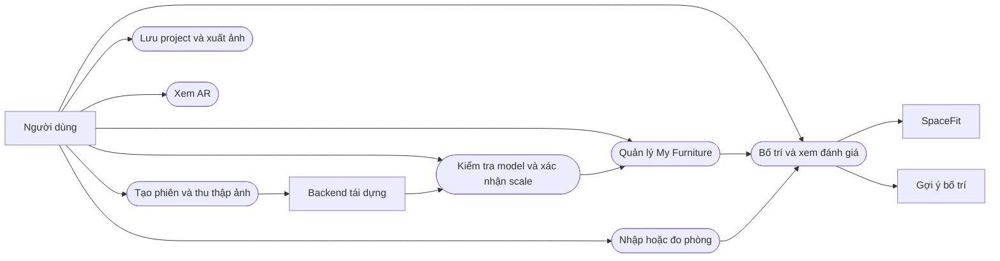
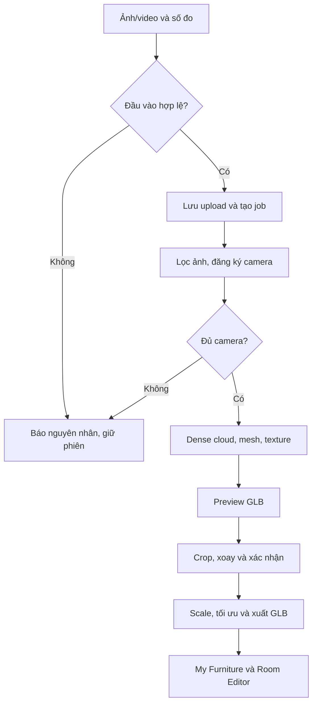

# AR-SpaceFit: báo cáo kỹ thuật và kịch bản bảo vệ

Bản thảo cập nhật ngày 03/10/2026. Cần bổ sung thông tin trường, sinh viên, giảng viên và thực nghiệm trước khi nộp. Đây là Markdown, chưa phải Word/PDF theo mẫu trường. Đối chiếu đủ 15 module và giới hạn triển khai trong [ma trận nghiệm thu](../REQUIREMENTS_ACCEPTANCE.md).

## 1. Tóm tắt

**Tên đề xuất:** Hệ thống quét nội thất, tái tạo mô hình 3D và hỗ trợ đánh giá bố trí trong không gian phòng.

AR-SpaceFit kết hợp ứng dụng Android với backend trên laptop. Người dùng chụp hoặc nhập nhiều ảnh/video của một món nội thất. Backend xử lý photogrammetry, tạo bản xem trước để kiểm tra hướng, cắt nền và xác nhận số đo tham chiếu. Ứng dụng lưu GLB trong kho, hỗ trợ bố trí trong phòng chữ nhật, đánh giá ràng buộc hình học và xem thiết kế qua ARCore trên thiết bị tương thích.

Đóng góp cấp ứng dụng là tích hợp luồng dữ liệu, kiểm tra scale có người xác nhận, lưu phiên bền vững và bộ đánh giá hình học có thể giải thích. Đề tài sử dụng COLMAP, OpenMVS, Blender và ARCore có sẵn, không tuyên bố tự phát minh hoặc huấn luyện thuật toán của chúng.

**Tình trạng:** các module đã có mã nguồn, nhưng chưa nghiệm thu toàn luồng tái dựng vật thật. Máy đã có COLMAP 4.2.0, OpenMVS 2.4.0 và Blender 5.2.2 LTS; bốn bài kiểm thử Blender thật đạt. Video ghế nhựa xanh dài 9,42 giây đã được thử với số đo rộng 15 cm, dài 25 cm. Lượt retry 01/10 chỉ đăng ký được 40/150 camera trong component tốt nhất, dưới ngưỡng 90, nên dừng với lỗi và không tạo GLB giả. Thời gian mapper khoảng 11,5 phút chỉ là thời gian của stage thất bại, không phải thời gian tái dựng thành công. Chưa có số liệu độ chính xác mesh, FPS, sai số kích thước độc lập hoặc tỷ lệ quét thành công.

OpenMVS Windows từng bị Code Integrity chặn `OpenEXR-3_3.dll`; ngày 03/10 COLMAP Windows cũng bị chặn `Imath-3_2.dll`. Theo lựa chọn của chủ máy, runtime hiện dùng **COLMAP CPU 3.9.1 và OpenMVS CPU 2.4.0 trong Docker**, pin image ID riêng; Blender vẫn chạy Windows. Bản Windows COLMAP 4.2 được giữ để rollback có kiểm tra, không sửa bảo vệ Windows. Bài mapper tổng hợp dùng 5 camera và 200 correspondences đã biết chỉ xác nhận thực thi hình học, không thay nghiệm thu quét thật. Kết quả gate mới phải xem [TEST_RESULTS.md](../TEST_RESULTS.md); startup thành công không chứng minh tái dựng đúng vật. Trước mỗi lần quét, API/worker kiểm readiness hiện tại trên ổ chứa data. Xem [NATIVE_RUNTIME.md](../NATIVE_RUNTIME.md).

## 2. Bài toán và phạm vi

Người dùng biết kích thước đồ và phòng nhưng khó hình dung vị trí, hướng xoay và vùng cửa bị cản. Hệ thống hỗ trợ thử bố trí trước khi di chuyển đồ thật, đồng thời tái sử dụng mô hình đồ đã có.

Đầu vào: ảnh/video của vật đứng yên, ít nhất một số đo thật, kích thước phòng hoặc ba điểm sàn AR và thông tin cửa đánh dấu tay. Đầu ra: GLB có texture khi thành công, metadata kích thước, cảnh báo không gian, project và ảnh thiết kế.

Giới hạn hiện tại:

- Phòng chữ nhật, đồ đặt trên sàn, footprint chữ nhật xoay và chiều cao phủ bì.
- AR lấy ba điểm sàn A–B–C. Chiều cao nhập tay, chưa quét mesh toàn bộ tường/trần.
- Hướng dẫn ba vòng chụp. Đếm ảnh và cảnh báo ML Kit chưa chứng minh đủ 360°.
- Vùng cửa là chữ nhật giữ trống. Chưa mô phỏng cung cánh cửa hoặc chứng minh lối đi liên tục.
- Auto Layout là heuristic có ràng buộc, chưa dùng AI tạo sinh.
- Backend một người dùng trong mạng tin cậy, chưa là dịch vụ production đa người dùng.

## 3. Yêu cầu và use case

| Mã | Chức năng | Tiêu chí chấp nhận |
|---|---|---|
| UC01 | Thu thập ảnh/video | Lưu phiên, báo ảnh mờ, giới hạn số ảnh và upload |
| UC02 | Tái dựng | Job ID, stage, progress, lỗi, hủy, retry và log |
| UC03 | Hiệu chỉnh | Xem GLB, crop, xoay và xác nhận trục tham chiếu |
| UC04 | Kho nội thất | Mở cục bộ, metadata, đổi tên, dùng lại trong project |
| UC05 | Phòng | Nhập số đo hoặc ba điểm AR, đặt cửa đúng tường |
| UC06 | Bố trí | Di chuyển, xoay, khóa, nhân bản, xóa và snap |
| UC07 | SpaceFit | Cảnh báo vượt tường/trần, chồng đồ, cửa, clearance |
| UC08 | Tìm đồ vừa | Xét kho tại tâm hợp lệ và lưới 11×11 trong vùng/phòng, góc 0°/90°; kiểm lại dữ liệu trước thêm |
| UC09 | Gợi ý | Giữ đồ khóa, chỉ trả phương án đủ đồ qua kiểm tra |
| UC10 | AR Preview | Neo sàn, giữ đơn vị mét, xoay/dịch thiết kế |
| UC11 | Lưu và xuất | Mở lại snapshot, Before/After, xuất PNG |

Sơ đồ mô tả tác nhân/chức năng ở mức tổng quan, không phải ký pháp UML use-case đầy đủ. Kiến trúc triển khai, sequence và ERD: [ARCHITECTURE.md](../ARCHITECTURE.md).

## 4. Thiết kế và xử lý dữ liệu

Android dùng Kotlin, Compose, CameraX, Room Database và SceneView/Filament. Backend dùng FastAPI, SQLite, OpenCV và công cụ native. Room lưu đường dẫn GLB/metadata. Project lưu snapshot phòng và placement để chỉnh kho không làm biến dạng thiết kế cũ.

Phiên upload được gắn với laptop và giữ nguyên bộ ảnh/video kể từ trước lần POST đầu tiên. Nếu mất phản hồi, gửi lại dùng cùng request ID và cùng input; đổi input cần phiên mới. Cấu hình laptop được chụp tại đầu thao tác, không đọc lại sau một request đang chờ. Khi tải lại model, app giữ GLB cũ cùng metadata kích thước cũ; chỉ công bố cặp GLB/metadata mới sau khi tải và kiểm tra GLB thành công. Preview chưa hiệu chỉnh không được thay thế model đủ điều kiện lưu kho.

Mỗi lệnh native có timeout, có thể dừng khi hủy job. Job đang chạy lúc server dừng chuyển sang gián đoạn, giữ ảnh để retry. Không thay reconstruction thất bại bằng model tham số. Luồng Gemini năm ảnh cũ còn riêng và cần phân biệt nguồn model.

## 5. Thuật toán

### Chuẩn bị ảnh và tái dựng

OpenCV lấy frame phân bố trên toàn video. Ảnh nhỏ, mờ hoặc trùng bị loại. Độ sắc nét dùng phương sai Laplacian sau chuẩn hóa kích thước. Ngưỡng hiện là tham số cần đánh giá trên dữ liệu thật.

COLMAP trích feature, matching và ước lượng camera. Backend chọn sparse model có nhiều ảnh đăng ký nhất, yêu cầu ít nhất 60% ảnh hợp lệ và tối thiểu 10 ảnh đăng ký. OpenMVS tạo dense cloud, mesh, refine và texture. Kiểm tra này chưa bảo đảm bề mặt hoàn chỉnh.

Blender nhập OBJ có texture, crop, xoay, giảm số mặt mục tiêu và xuất GLB. Script chuyển hệ trục Blender/GLB trước khi tính số đo.

### Scale

Sau xác nhận crop/orientation, hệ thống đo extent theo trục được chọn:

`s = kích_thước_thật_mét / extent_model`.

Scale đồng đều giữ tỷ lệ, tâm x/z về gốc, đáy về y=0. Khi dùng chiều rộng làm tham chiếu, không dùng sai số chiều rộng sau scale để chứng minh đo chính xác. Phải đối chứng hai chiều còn lại hoặc đoạn đo độc lập.

### SpaceFit

SAT kiểm tra footprint chữ nhật xoay. Tiếp xúc cạnh không coi là chồng. Khoảng cách là khoảng cách đoạn–đỉnh nhỏ nhất. Sutherland–Hodgman tính giao với vùng cửa:

`tỷ_lệ_chắn_cửa = diện_tích_giao / diện_tích_vùng_giữ_trống × 100%`.

Điểm tối đa: 40 trong phòng, 25 khoảng trống, 20 không va chạm, 15 diện tích. Chắn cửa/cửa sổ trừ 25. Quyết định phù hợp kiểm tra thêm ràng buộc cứng. Điểm là quy tắc ứng dụng, chưa phải chuẩn an toàn hoặc xác suất phù hợp.

### Gợi ý bố trí

Giữ đồ khóa, sắp đồ còn lại theo diện tích giảm dần, xét lưới 21×21 ở hai hướng. Chấm điểm vị trí theo phong cách ưu tiên. Chỉ trả bố trí đủ đồ sau kiểm tra cuối. Không tìm được nghiệm có thể do lưới thô hoặc lựa chọn tham lam, chưa chứng minh không tồn tại cách xếp.

## 6. Kiểm thử và thực nghiệm

Kiểm thử phần mềm và thực nghiệm thị giác phải báo riêng. Test pass không chứng minh mesh giống vật thật. Kết quả và giới hạn: [TEST_RESULTS.md](../TEST_RESULTS.md).

- Hình học: xoay, khoảng cách, cửa, trần, vùng vừa đồ và đồ khóa.
- Persistence: migration, mở lại database, snapshot và metadata GLB.
- GLB: header, chunk, buffer và đơn vị cm/m.
- Backend: auth, upload, filename an toàn, trạng thái, idempotency, crop, phục hồi, blur/trùng, toàn video, timeout/hủy và native log.
- Android scan: Room thật + HTTP loopback fixture kiểm mất phản hồi upload, khởi tạo lại ViewModel, khóa input, đổi laptop giữa preflight, giữ model/scale khi tải lỗi, GLB hỏng và ngăn preview chưa scale vào kho. Fixture HTTP này không giả là kết quả quét vật thật.
- Instrumentation Android: điều hướng, GLB fixture, đặt vào phòng và scan. Fixture chỉ kiểm thử renderer.

### Kế hoạch dữ liệu thật

Bắt đầu với 3 món: ghế có texture, bàn gỗ, tủ có hoa văn. Mỗi món ít nhất hai lần thu thập độc lập. Đây là kế hoạch, chưa phải dữ liệu đã có. Ghi cả lần thất bại, giữ số đo gốc trước khi chỉnh.

| Trường | Dữ liệu cần ghi |
|---|---|
| Vật và scan ID | Tên, vật liệu, ngày, lần quét, người đo |
| Thu thập | Máy, số ảnh, vòng/độ cao, ánh sáng |
| Đối chứng | W/D/H bằng thước, trục tham chiếu |
| Xử lý | Ảnh hợp lệ/đăng ký, thời gian stage, lỗi |
| Model | W/D/H, polygon, GLB MB, lỗ/nền dư/texture |
| Android | Máy, thời gian mở, giật/crash, offline |
| AR | Số đo room, chiều độc lập, trôi tracking |

Sai số tuyệt đối `AE = |d_model − d_thước|` cm, tương đối `RE = AE / d_thước × 100%`. Tính MAE trên chiều độc lập, tách trục hiệu chuẩn. Mẫu nhỏ nên báo cả khoảng giá trị và số lần thất bại, không suy rộng mọi loại nội thất.

Checklist bề mặt: đủ chân/cạnh, không dính nền lớn, texture đúng vùng, không lỗ lớn. Chưa có mesh ground truth thì không công bố Chamfer Distance hoặc độ chính xác mesh định lượng.

## 7. Demo 5–7 phút

1. Giới thiệu mục tiêu, phạm vi phòng chữ nhật và nguồn model.
2. Mở scan history với bộ thật đã xử lý trước. Cho thấy stage, camera và preview.
3. Xác nhận hướng/crop/số đo. Xoay GLB trong kho, kiểm tra polygon/kích thước.
4. Thêm hai đồ vào phòng có cửa. Tạo va chạm, vượt tường và chắn cửa.
5. Tìm đồ vừa vùng, khóa một đồ rồi gợi ý. Giải thích heuristic không tự bỏ đồ.
6. Lưu/mở project, xuất ảnh, Before/After.
7. Thử AR trên máy tương thích, đối chiếu thước. Kết thúc bằng test và giới hạn.

Chưa có scan thật thì chỉ demo editor với nhãn nguồn rõ. Không gọi fixture là ghế tái dựng. Không có thiết bị AR thì trình bày module chưa nghiệm thu hoặc dùng video đã quay từ máy tương thích.

## 8. Câu hỏi bảo vệ

**Vì sao laptop?** Photogrammetry nhiều ảnh cần bộ nhớ/tính toán lớn. Backend tách xử lý khỏi UI, không cam kết thời gian trước khi đo.

**Vì sao nhập số đo?** Ảnh đơn mắt chưa đảm bảo scale tuyệt đối. Một tham chiếu sửa scale, không sửa sai hình dạng.

**Đóng góp riêng?** Luồng Android/LAN, phiên có phục hồi, đồng bộ GLB/metadata, footprint/cửa/clearance và kiểm tra bố trí.

**Phần nào AI?** ML Kit hỗ trợ phát hiện lúc chụp, Gemini là luồng tham số tùy chọn. SfM/MVS là tái dựng hình học, Auto Layout hiện là heuristic.

**AR thay thước?** Không. Phụ thuộc tracking, vị trí chạm, bề mặt và máy. Kết quả cần đối chứng.

## 9. Hướng phát triển

Ưu tiên nghiệm thu scan thật, sau đó segment vật thể, hướng dẫn bao phủ dựa pose, xử lý nền mesh và kiểm thử nhiều máy. Tiếp theo mới mở rộng phòng không chữ nhật, ràng buộc ngữ nghĩa, tìm đường đi và layout tối ưu. Production cần HTTPS, phân quyền và quản lý tài nguyên.

## Tài liệu tham khảo

- [COLMAP CLI](https://colmap.github.io/cli.html).
- [OpenMVS workflow](https://github.com/cdcseacave/openMVS/wiki/Usage).
- [Blender glTF export](https://docs.blender.org/manual/en/4.5/addons/import_export/scene_gltf2.html).
- [ARCore fundamentals](https://developers.google.com/ar/develop/fundamentals).
- [SceneView v2.3.0](https://github.com/SceneView/sceneview-android/tree/v2.3.0).

Threshold, API và quy tắc điểm mô tả mã nguồn AR-SpaceFit, không phải chỉ tiêu mà thư viện bảo đảm.
